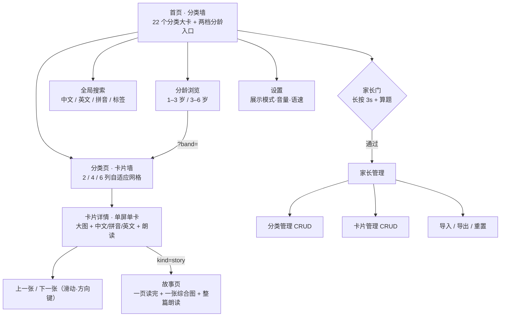

# 需求总览（FR Overview）

> 本目录存放全部**需求设计**文档。遵循 `agent/规约.md`：需求设计统一放在 `FR/` 下、按版本管理，并在本文件维护**总项目预览**与文档索引。

| 项 | 内容 |
| --- | --- |
| 产品名（暂定） | 童识 · 认知卡片 |
| 工程代号 | `early-learn` |
| 当前版本 | **v0.11（分类归属纠偏）已实现**：逐张核对 809 张后把 7 张放错分类的卡搬到应去的地方——蜜蜂蝴蝶→小虫子、鱼→海洋动物、鞋子帽子→穿戴、书包→学校、老师→职业。卡 id 含分类前缀所以**挪卡即换 id**：`SEED_VERSION` 9→10，用 `RETIRED_SEED_CARD_IDS` 在种子升级时对老用户本地「先剔后补」；图片与音频 `git mv` + 两个 manifest 同步。总数仍 809 张 / 22 分类；**389 例 / 32 文件**全绿、主 chunk gzip 195.58（余量 2.00）、CSS 8.86 一字未动；零契约变更（不动字段 / 路由 / `schemaVersion`）。上一版 **v0.10（首页信息架构）已实现**：需求方反馈「首页不好看、上面 1–3 岁、下面又是卡片、分类不明确」。① 分龄大卡改「左文右图」（右上 88 / 104px 封面，复用水果 / 古诗封面，不新出图）；② 分类墙按语义分四段——认物 17 / 字卡 2（汉字 321 排在数字 28 前）/ 诗文 2（古诗 50 + 成语 150）/ 绘本 1（故事 50）；③ 三小段改「三列并排 + 横卡」，1440 首页总高 1981 → **1368**；④ 管理区新建分类落「更多」兜底段，不被吞；⑤ 为腾预算把 `DisplayModeSwitch` / `SettingsPage` / `AdminGuard` / 家长门改懒加载，主 chunk gzip 197.57 → **195.48**（余量 2.10）；**382 例 / 32 文件**全绿、CDP 360 / 768 / 1440 / 1826 四档无溢出；零契约变更。**v0.8（分龄与拼音辅助）已实现**：首页两档分龄入口（1–3 岁 / 3–6 岁）、`/age/:band` 分龄分类墙、分类页 `?band=` 筛选与详情页按龄翻页（全部复用既有 `difficulty` 字段，零契约变更）、管理区拼音候选（按字点选，不静默生成）；v0.8.0 实测 307 例全绿、主 chunk gzip 197.08 kB（+1.08，偏差 D-1）、CDP 360/1440/1826 三档无溢出；复审已修「详情 → 故事页 → 详情」往返丢 `?band=` 与拼音点选覆盖已确认读音；笔顺动画原单列 v0.8.1，现并入 v0.9。**v0.9（笔顺与生产工具）已开工**（版本号 0.9.0）：笔顺链路已落（T-X1~T-X4）——321 字按 8 个主题组切片 + `manifest.json`（「有没有按钮」不读 manifest，主 chunk 只 +0.48 gzip）、汉字详情「看笔顺 / 停止 / 重播」三态播放器、遵循「减少动画」、断网回落静态大字；CSV 录入的解析器与行映射已落（RFC4180 子集 + 10 列映射 + **整表拒绝** + 同分类同名跳过，尚未接页面）、上传图压缩已接进卡片表单（T-X9：原图上限 500 KB → 8 MB、最多 12 档压到 ≤150 KB、选图期间「压缩中…」并禁用重选）、内容快照的端口与「保留 5 份 / 单份 8 MB 拒建」已落（IndexedDB 实现与面板待 T-X11）；**370 例 / 30 文件**全绿、CDP 360 / 1440 与断网实测通过。余下数据管理两件（CSV 批量录入且整表拒绝的页面与写入、IndexedDB 保留 5 份内容快照与一键回滚）待实现，零契约变更；PRD / 技术方案见 §7。上一版 **v0.7（搜索与离线）已实现**：新增 `/search` 全局搜索（中文 / 英文 / 拼音 / 标签四类输入，12 张一页 + 返回链路）、PWA 安装与离线（manifest + 手写 SW，断网仍能打开外壳）、路由懒加载首屏瘦身（主 chunk 613.95 → 580.27 kB，gzip 206.11 → 196.00）、超宽屏 ≥1700 px 容器 1680 且顶栏与容器左边缘对齐；**零契约变更**。上一版 **v0.6（成语词典）收尾到 v0.6.2**：新增第 22 分类「成语」150 条（寓言故事 / 学习求知 / 品德修养 / 自然景物 / 生活常理各 30）、新 `kind=idiom` 与 5 个可选字段（释义 / 例句 / 近义·反义 / 出处）、水墨四字卡 150 张与分类封面（**卡面画成语里真实存在的 2 件实物**，不再画泛化意境）、详情页成语版式、听音选图排除成语；总量 659 → **809 张 / 21 → 22 分类**，图片 831 张、音频仍 659 条，`SEED_VERSION` 8 → 9，`schemaVersion` 仍为 1。v0.6.2 界面改版：容器分档（列表页 1440 / 详情页 960）、分类卡等高、首页顶栏合并为一条、主色由亮蓝改墨绿、源码地址三处入口。上一版 v0.5 内容大扩容（汉字 321 / 数字 28 / 古诗 50 / 四新分类）已实现 |
| 交付形态 | 纯前端 Web 应用（PC / 平板 / 手机浏览器），**无后端** |
| 目标用户 | 1–3 岁幼儿的家长（使用者）+ 幼儿（观看者） |
| 内容形态 | 分类化的认知卡片：图片 + 中文 + 拼音 + 英文 + 点读发音，含汉字字卡、古诗卡、故事卡与成语卡；内置 809 张卡片与 831 张脚本生成的原创插画（汉字 321 字、古诗 50 首、故事 50 本且每本 1 张综合图、成语 150 条且每条 1 张水墨四字卡，22 个分类各 1 张封面），家长可上传自己的照片替换；分类内可再按主题组筛选（汉字 8 组、古诗 3 组、故事 4 组、成语 5 组）并分页浏览 |
| 最近更新 | 2026-10-31 |

---

## 1. 产品一句话

把「翻书认物」这件事搬到浏览器里：**按分类管理认知卡片，一张大图配中英对照与发音，家长可自己增删内容。**

## 2. 为什么做（问题与机会）

| 现状痛点 | 本产品的解法 |
| --- | --- |
| 纸质认知书内容固定，孩子认完了就闲置 | 内容可编辑、可扩展，一套壳装无限内容 |
| 图册买多了囤积占地方、找图不系统 | 分类归一管理（动物/水果/交通工具…），支持检索与导入导出 |
| 手机上东一张西一张，广告多、误点就跑偏 | 单页单卡、无广告无外链、大按钮防误触、管理入口加家长门 |
| 中英对照只能靠家长自己念，口音不统一 | 内置语音朗读（中文/英文可切），家长不必全程陪读 |
| 认汉字要另外买字卡，图与字脱节 | 汉字字卡与实物卡同一套浏览体验，字 + 拼音 + 组词 |

## 3. 目标用户与核心场景

| 用户 | 场景 | 关键诉求 |
| --- | --- | --- |
| 家长（25–40 岁，主力） | 睡前/饭后陪孩子看 5–15 分钟；周末整理孩子最近感兴趣的内容 | 打开就能用、不用注册、内容可信、能自己加 |
| 幼儿（1–3 岁） | 自己点大图看、听发音、左右滑动换卡 | 图大、按钮大、不会点退出、不弹广告 |
| 早教老师（次要，v0.2+） | 按主题准备课堂卡片 | 分类清晰、可批量导入导出 |

> 1–3 岁的核心特征决定了产品形态：**不识字、手指精度低、注意力短、会乱点**。因此界面以「图 + 大按钮 + 语音」为主，文字仅作家长辅助信息。

## 4. 核心价值主张

1. **分类即入口**：22 个主题分类，一屏看见全部主题，不埋三层菜单。
2. **一卡三读**：同一张卡同时承载 中文 / 拼音 / 英文，并可分别朗读，天然形成对照。
3. **家长可管理**：内置 809 张种子卡片，同时开放管理界面（分类与卡片 CRUD、导入导出），不依赖开发者更新。
4. **本地即存储**：数据存浏览器本地，无账号、无上传、无隐私收集，打开即用。
5. **两段年龄各看各的**：同一份 809 张内容按认知难度分两档——1–3 岁看实物与日常（约 575 张），3–6 岁读字、读诗、讲成语（约 608 张）；家长不用再自己猜「这张会不会太难」。

## 5. 信息架构

**路由草案**（技术细节见 `NFR/v0.1/技术方案.md`）

| 路由 | 页面 | 说明 |
| --- | --- | --- |
| `/` | 首页 | 分类墙 + 设置/管理入口 |
| `/c/:categoryId` | 分类页 | 该分类卡片网格 |
| `/card/:cardId` | 卡片详情 | 支持直接深链打开；故事卡带「开始阅读」 |
| `/story/:cardId` | 故事页 | 一次读完 4–8 段正文（种子 6 段）+ 1 张综合图，旧 `?page=` 链接照旧可用 |
| `/settings` | 设置 | 展示模式、语音开关与语速 |
| `/favorites` | 我的收藏 | v0.4 新增：收藏卡片墙 + 最近浏览 24 条 + 空态 |
| `/recent` | 接着看 | v0.5.1 新增：最近浏览 24 张独立页（从首页正文横滑区收成入口条的菜单项，不占分类墙版面） |
| `/review` | 复习单卡流 | v0.4 新增：只出「不认识」、每轮 ≤ 10 张、M=0 有空态 |
| `/search` | 全局搜索 | v0.7 新增：一次搜全部 809 张，命中中文 / 英文 / 拼音（可不带声调）/ 标签；`?q=` 可分享、`?page=` 可返回 |
| `/age/:band` | 分龄浏览 | v0.8 新增：`1-3` / `3-6` 两档，展示该龄段的分类墙（角标为适龄张数）；点分类进入带 `?band=` 的卡片墙 |
| `/quiz` | 听音选图 | v0.4 新增：一局 10 题四选一，发音不可用不开局 |
| `/guide` | 给家长的使用说明 | v0.4 新增：六条主题，页内不放管理入口 |
| `/admin` | 家长管理 | 需家长门；含分类/卡片/数据三个页签 |
| `*` | 404 | 兜底返回首页 |

> 实现采用 **HashRouter**，实际地址形如 `#/card/animals-cat`（静态托管零 rewrite，取舍见 `NFR/v0.1/技术方案.md` §6）。

## 6. 版本路线图

| 版本 | 主题 | 关键能力 | 状态 |
| --- | --- | --- | --- |
| **v0.1** | MVP · 能看能管 | 分类浏览、卡片详情、中英对照 + 拼音、点读发音、家长本地管理（CRUD + 导入导出）、451 张内置卡片素材（含汉字 241 字、古诗 30 首）、分类内主题组筛选与分页 | ✅ 已实现 |
| **v0.2** | 故事绘本 | 第 17 分类「故事」：50 本故事（童话 20 / 生活习惯 15 / 情绪社交 10 / 自然认知 5）、`kind=story` + `pages[]`（正文段落）+ `moral`、独立故事页 `/story/:cardId`（一页读完、整篇朗读、Esc 返回）、每本 1 张多角色综合插图（共 50 张） | ✅ 已实现 |
| **v0.3** | 视觉一致性 | 故事综合图主体由 emoji 单色剪影改为**与背景同族的程序化扁平插画**（同色板、无描边、统一落地阴影、统一脸型），emoji 退出故事图；同版收尾：50 张逐张体检修正 18 条，实物卡 501 张与诗词 30 张封面一并换成同族画风；无功能/字段变更 | ✅ 已实现 |
| v0.4 | 听得准 · 记得住 | **M-A 发音根治** ✅：英文点读走应用自带音频（501 条程序化生成 + 预录适配器，失败回退 WebSpeech）；**M-B 留下痕迹** ✅：进度仓储与 store、详情页收藏/认识·不认识、收藏页与最近浏览 24 条；**M-C 复习与游戏** ✅：复习队列 `/review`（每轮 ≤10 张）与听音选图 `/quiz`（四选一、干扰同分类优先、答错无负面反馈）、首页三入口条 + 统计一句话 + 接着看横滑（v0.5.1 改为入口条菜单项 + 独立页 `/recent`）；**M-D 解放双手** ✅：详情页连播（2s 自动下一张、四类中断、到末尾不循环）、`/guide` 家长使用说明页、管理区清除学习进度（家长门），并补做收藏 Toast 与只读提示一次 | ✅ 已实现 |
| **v0.5** | 内容大扩容 | 汉字 241 → 321、数字 1–100 精选（10 → 28）、新增四个主题分类（海洋动物 / 小虫子 / 职业 / 穿戴 各 10 张）、古诗 30 → 50；总量 501 → 659 张 / 17 → 21 个分类；**零契约变更**（`Card` 字段、路由、导入导出不动） | **已实现**（M-A 结构 + M-B 内容全铺，659 张 / 21 分类、256 例、gzip 181.69KB） |
| **v0.6** | 成语词典 | 第 22 分类「成语」150 条（寓言故事 / 学习求知 / 品德修养 / 自然景物 / 生活常理，各 30 条）；新 `kind=idiom`：释义 + 2 条例句 + 近义/反义 + 出处，五项均为可选字段、`schemaVersion` 仍 1；水墨四字卡 150 张 + 分类封面（每条成语画 2 件实物意象）；详情页成语版式；管理区成语表单；听音选图排除成语；总量 659 → 809 张 / 21 → 22 分类 | **已实现**（v0.6.0 落地 / v0.6.1 配图重做，809 张 / 22 分类、274 例、gzip 205.63KB；偏差见 PRD §13） |
| **v0.6.2** | 界面改版 | 零功能变更的视觉 / 形态重构：容器分档（列表页 1440 / 详情页 960）、分类卡等高且名称单行、首页顶栏合并为一条、主色改墨绿并统一分类色、分类页固定 2/4/6 列、成语详情页左图右文、源码地址三处入口 | **已实现**（274 例全绿；360 / 1440 两档实测无溢出，见 PRD §4） |
| **v0.7** | 搜索与离线 | 全局搜索 `/search`（四类输入 + 分类角标 + 分页 + 返回链路）、PWA 安装与离线（manifest + 手写 SW，导航网络优先 / 静态缓存优先）、路由懒加载首屏瘦身（主 chunk 613.95 → 580.27 kB）、超宽屏 ≥1700 px 补一档 1680 且顶栏与容器内容左边缘对齐 | **已实现**（281 例全绿；主 chunk gzip 196.00；360 / 1440 / 1826 与详情页四档实测无溢出、断网 reload 首页完整） |
| ~~v0.7（原计划）~~ | 内容与体验 | 汉字笔顺动画、多龄段模式（1–3 / 3–6）、拼音自动标注 | 顺延至 v0.8（PWA 一块已被 v0.7 用掉） |
| **v0.8** | 分龄与拼音辅助 | 首页两档分龄入口（1–3 岁「启蒙」/ 3–6 岁「进阶」）、`/age/:band` 分龄分类墙、分类页 `?band=` 筛选（含「看全部」）、详情页按龄翻页与返回链路、管理区拼音候选（按字列出多音字全部读音，点选才写入）；**零契约变更**（复用 `difficulty`，不动 `schemaVersion` / `SEED_VERSION`） | **已实现**（576 / 609 张适龄、蔬菜 6/13、拼音字典 3755 字 gzip 19.1 kB；307 例全绿；偏差 D-1：主 chunk +1.08 kB，见 PRD §3） |
| ~~v0.8.1~~ | 汉字笔顺动画 | 321 张汉字卡全覆盖的逐笔演示；外部笔顺字形数据 + 按汉字 8 个主题组切片懒加载（自 v0.8 顺延） | 并入 v0.9（不单列） |
| **v0.9** | 笔顺与生产工具 | ① **笔顺**：汉字详情逐笔动画（321 字全覆盖、8 主题组切片懒加载、`hanzi-writer` + Arphic 许可声明）、遵循「减少动画」、无数据不显示按钮；② **生产工具**：CSV 批量录入（预览 + 整表拒绝 + 模板）、上传图压缩（最长边 1280 / WebP / ≤150 KB）、IndexedDB 内容快照与一键回滚（保留 5 份、恢复前自动备份）；**零契约变更**（不改字段 / 路由 / `schemaVersion` / `SEED_VERSION` / 导出 JSON） | **进行中**（笔顺链路 T-X1~T-X4 已落：8 组数据 + 播放器 + 详情页接入；CSV 解析与行映射 T-X5~T-X6 已落；图片压缩纯函数 T-X8 与接入表单 T-X9、快照端口 T-X10 已落；CSV 预览 / 写入、快照面板待实现） |
| **v0.10** | 首页信息架构 | 零功能变更的信息架构重构：分龄卡改「左文右图」大卡（封面复用分类封面）、分类墙按语义分四段（认物 / 字卡 / 诗文 / 绘本）、三小段三列并排 + 横卡、新建分类落「更多」兜底段；为腾主 chunk 预算把 `DisplayModeSwitch` / `SettingsPage` / `AdminGuard` / 家长门改懒加载；**零契约变更**（不加字段 / 路由 / 依赖） | **已实现**（382 例 / 32 文件；主 chunk gzip 195.48、CSS 8.86；1440 首页总高 1981 → 1368；CDP 四档无溢出；见 PRD §5 / 技术方案 §7） |
| **v0.11** | 分类归属纠偏 | 逐张核对后把 7 张放错分类的卡搬到应去的分类（蜜蜂蝴蝶→小虫子、鱼→海洋、鞋子帽子→穿戴、书包→学校、老师→职业）；卡 id 含分类前缀**挪卡即换 id**，老用户数据靠 `SEED_VERSION` 9→10 + `RETIRED_SEED_CARD_IDS` 升级时先剔后补；**零契约变更**（不动字段 / 路由 / `schemaVersion`） | **已实现**（809 张 / 22 分类不变；389 例 / 32 文件全绿；主 chunk gzip 195.58 余量 2.00、CSS 8.86 不变；见 PRD §5 / 技术方案 §7） |
| **v0.12** | 首页段卡改版 | 实拍核对四个版式问题（L-1 入口倒挂：认物 17 tile 占 3 行只 210 张 / L-2 底部三列失衡 / L-3 颜色形状封面近空白 / L-4 360 档首页 3043px）：认物收成 **4 张段卡**（动物与植物 71 / 身边的物什 65 / 人物与动作 46 / 自然与概念 28），与字卡 349 / 诗文 200 / 绘本 50 用**同一套段卡样式**入网格；新增二级页 `/group/:groupId`（仿分龄墙）；顺手重绘 colors / shapes 两张封面；**零契约变更**（段是展示层静态清单，不加字段 / 不动两个版本号） | **规划**（见 `FR/v0.12/PRD-首页段卡改版.md` / `NFR/v0.12/技术方案-首页段卡改版.md`，决策 Q-1~Q-5、任务 T-Q1~T-Q6） |
| v1.0 | 云端协同 | 账号体系、多端同步、后端 API（替换仓储实现即可，见 NFR ADR-003） | 待规划 |

> 版本号规则：`v主.次`，主版本号变更代表**数据模型或路由契约不兼容**；次版本号代表向下兼容的功能增量或可作为一次交付验收的视觉/形态重构（不引入新功能）。v0.3 占用原规划的「学习闭环」，v0.5 占用「内容与体验」（改为主题为内容扩容），v0.7 抽用原「内容与体验」里的 PWA 一块（改为搜索与离线），v0.8 用掉「多龄段模式 + 拼音自动标注」两块（改为分龄与拼音辅助），笔顺动画原单列 v0.8.1（同为向下兼容的功能增量），后与 v0.9 生产工具合并为 v0.9「笔顺与生产工具」，其余规划依次顺延。

## 7. 需求文档索引

| 文档 | 路径 | 内容 | 状态 |
| --- | --- | --- | --- |
| 需求总览 | `FR/README.md` | 产品全景、路线图、索引（本文件） | v0.4 ✅ |
| 产品需求文档 | `FR/v0.12/PRD-首页段卡改版.md` | 「首页段卡改版」：L-1~L-4 实拍问题清单、认物 17 类逐类张数、US-Q1~Q4、7+1 段划分口径表（总数守恒 809）、二级页与首页高度预算、验收 6 条、本版不做 4 条 | v0.12.0 规划 |
| 产品需求文档 | `FR/v0.11/PRD-分类归属纠偏.md` | 「分类归属纠偏」：7 张错位卡事实表（含逐张证据）、US-Z1~Z4、验收 5 条（总数仍 809 / 22、`schemaVersion` 仍 1、`SEED_VERSION` 9→10）、本版不做 4 条（不动首页分段 / 不解决入口倒挂 / 不重画图片 / 不做收藏 id 跟随） | v0.11.0 已实现 |
| 产品需求文档 | `FR/v0.10/PRD-首页信息架构.md` | 「首页信息架构」：改版前五项诊断（两条轴叠放 / 22 类平铺 / 汉字占 39.7% / 分龄卡纯文字 / 预算只剩 0.01 kB）、US-Y1~Y6、验收 5 条、本版不做 4 条、派生任务 H-1~H-5 | v0.10.0 已实现 |
| 产品需求文档 | `FR/v0.9/PRD-笔顺与生产工具.md` | 「笔顺与生产工具」：孩子侧（笔顺只有笔画数）与家长侧（只支持 JSON 全量导入 / 上传图不压缩导致约 7 张上限 / 无快照回滚入口）两组诊断、US-X1~X9、验收标准 13 项、本版不做 8 条、口径 4 条已确认 + 细节 7 条 | v0.9.0 进行中（笔顺四项验收已回填实测） |
| 产品需求文档 | `FR/v0.8/PRD-分龄与拼音辅助.md` | 「分龄与拼音辅助」：分龄 / `difficulty` 沉睡 / 拼音录入 / 笔顺数据四项诊断、US-W1~W6、验收标准（已回填实测）、本版不做 6 条、3 条口径（已确认） | v0.8.0 已实现 |
| 产品需求文档 | `FR/v0.7/PRD-搜索与离线.md` | 「搜索与离线」：前台无搜索 / 无 manifest / 首屏单 chunk / 超宽屏错位四项诊断、US-V1~V8、搜索与安装验收（含 CDP 断网实测）、本版不做 | v0.7.0 已实现 |
| 产品需求文档 | `FR/v0.6/PRD-界面改版.md` | 「界面改版」：留白诊断、容器分档、分类卡等高、首页顶栏合并、墨绿主色与分类色统一、成语详情页重排、源码入口三处、两档实测与「不做」清单 | v0.6.2 已实现 |
| 产品需求文档 | `FR/v0.6/PRD-成语词典.md` | 「成语词典」：150 条（5 主题组 × 30）、`kind=idiom` 与五个新字段、水墨四字卡（每条 2 件实物意象）、详情页成语版式、管理区表单、内容清单与 DoD、实现偏差回写（§13） | v0.6.1 已实现 |
| 产品需求文档 | `FR/v0.5/PRD.md` | 「内容大扩容」：US-C1~C6 汉字 / 数字 / 新分类 / 古诗 / 升级合并 / 玩法接通、80 字与 20 首诗与 40 张新卡的逐条清单、内容与管线口径、本版明确不做的事、DoD | v0.5.0 已实现 |
| 产品需求文档 | `FR/v0.4/PRD.md` | 「听得准 · 记得住」：US-E1/E2 发音、US-A1~A7 学习闭环、音频口径与决策变更、交互约束、DoD | v0.4.0 已实现 |
| 产品需求文档 | `FR/v0.1/PRD.md` | 用户故事、功能模块、交互约束、边界异常、验收标准 | v0.1.8 已实现 |
| 内容体系与首批卡片清单 | `FR/v0.1/内容体系与首批卡片清单.md` | 16 类分类定义、451 张卡片清单（汉字 241、古诗 30）、汉字七主题组、字段填写规范、图片采集与授权规范 | v0.1.7 ✅ |
| 故事绘本需求 | `FR/v0.2/PRD-故事绘本.md` | 故事规模与配比、US-S1~S6、故事页一屏读完的交互约束、`pages`/`moral` 字段、综合图主体画风约束、边界与 DoD | v0.3 ✅ |

**技术设计索引**：见 [`NFR/README.md`](../NFR/README.md)；**Agent 协作规约**：见 [`AGENT.md`](../AGENT.md)。

## 8. 需求变更流程

1. 需求变更先改文档、后改代码，禁止「代码先行、文档补录」。
2. 同一版本的**向下兼容调整**（新增字段可选、文案调整、样式微调）→ 直接编辑当前版本文档，并在文档末尾「变更记录」追加一行。
3. **破坏性变更**（路由、数据模型、核心交互）→ 新开版本目录（如 `FR/v0.2/`），旧版本文档冻结，仅修错别字。
4. 每份需求文档必须包含：文档信息表、变更记录表、明确的「不做什么」。
5. 任何需求文档的新增/过期，必须同步更新本文件第 7 节索引。

## 9. 术语表

| 术语 | 含义 |
| --- | --- |
| 分类（Category） | 主题分组，如「动物」。含封面图、颜色、排序 |
| 卡片（Card） | 一张认知卡，是内容最小单位。`kind=object` 为实物卡，`kind=character` 为汉字字卡，`kind=poem` 为古诗卡，`kind=story` 为绘本故事 |
| 实物卡 | 真实照片 + 中/拼音/英文，如「苹果 · píng guǒ · apple」 |
| 汉字字卡 | 单字 + 拼音 + 笔画数 + 组词，如「人 · rén · 2 画 · 大人/人民」 |
| 诗词卡 | 古诗/词一首一张卡：标题 + 朝代·作者 + 按句分行的正文 + 白话译文，如「静夜思 · 唐 · 李白」；正文按句分行存储（七言一句一行、五言两句一行、词按句分行） |
| 故事卡 | 一个故事一张卡：标题 + 拼音/英文 + 寓意 + 4–8 段正文（种子统一 6 段）+ 1 张多角色综合插图，如「三只小猪」 |
| 故事页 | 故事卡专用的单页阅读页 `/story/:cardId`：一屏读完所有段落、一张综合图（点图或按钮朗读整篇）、底部寓意与返回，不翻页 |
| 点读 | 点击卡片/按钮朗读对应语言的发音 |
| 家长门 | 进入管理区的验证手势，防止幼儿误入设置 |
| 种子数据（Seed） | 随应用内置的首批分类与卡片，首次访问时写入本地存储 |
| PWA / 离线外壳 | 可「装到桌面」并断网打开的形态：`manifest.webmanifest` 提供图标与名称，Service Worker 预缓存外壳（`index.html` + 入口资源）并在断网时回退，图片与音频走运行时缓存 |
| 龄段（AgeBand） | 同一份内容的两个年龄档：`1-3`（难度 1 + 2）与 `3-6`（难度 2 + 3）；难度 2 为两档重叠带。由 URL `?band=` 承载，不改卡片字段 |
| 只读模式 | 本地存储不可用时的降级状态：可浏览种子数据，管理功能禁用 |

## 10. 变更记录

| 日期 | 版本 | 变更内容 | 作者 |
| --- | --- | --- | --- |
| 2026-10-28 | v0.1 | 首次建立需求总览：确定 1–3 岁定位、纯前端形态、v0.1 范围与路线图 | PM / Agent |
| 2026-10-28 | v0.1.1 | 实现回写：v0.1 状态改为已实现；内容形态改为「内置原创插画 + 家长可上传照片」；索引同步 PRD v0.1.1 | Agent |
| 2026-10-28 | v0.1.5 | 内容形态扩展为「汉字字卡 + 古诗卡」：新增第 16 分类「古诗」与 30 首诗词、卡片新 `kind=poem`；内容形态 361 → 391 张 / 15 → 16 分类；术语表新增「诗词卡」；索引同步 PRD v0.1.5 | Agent |
| 2026-10-29 | v0.1.6 | 汉字补齐：汉字 181 → 241 字（新增时间与数量 / 家人与五官 / 常见动物 / 交通与地点 / 反义与形容五组 60 字）；内容形态 391 → 451 张；索引同步 PRD v0.1.6 | Agent |
| 2026-10-29 | v0.1.7 | 分类页分组与分页：汉字二十组归并为七主题（数字与量 25 / 身体与家人 37 / 自然与季节 28 / 动物与植物 22 / 方位与地点 34 / 动作与形容 40 / 生活与学习 55），古诗分唐诗 / 宋词；每页 12 张、URL 可恢复；索引同步 PRD v0.1.7 | Agent |
| 2026-10-29 | v0.2 | 故事绘本大版本：① 新增第 17 分类「故事」与 50 本故事（童话 20 / 生活习惯 15 / 情绪社交 10 / 自然认知 5）；② 卡片新增 `kind=story` + `pages[]` + `moral`；③ 新增 `/story/:cardId` 故事页；④ 故事分类复用组筛选与分页，故事组 key 带 `story-` 前缀；⑤ 管理区支持故事类型（寓意 + 每段正文）；⑥ 内容形态 451 → 501 张 / 16 → 17 分类；⑦ 路线图顺延（学习闭环移至 v0.3）；⑧ 新增 `FR/v0.2/PRD-故事绘本.md` | Agent |
| 2026-10-29 | v0.2.2 | 需求方反馈「故事在一页，配一个综合的图就行」：① 取消逐页翻页与页码，`pages[]` 由「页」改作「正文段落」，故事页一屏读完；② 每本只保留 1 张多角色同场景综合图（脚本按首段场景 + 全书主体计数聚合），删掉 300 张分页插图；③ 故事插图 350 → 50 张、全站 818 → 518 张；④ `pages[].image` 降为可选（旧数据与旧 `?page=` 链接兼容）；⑤ 详情按钮「翻开故事」→「开始阅读」、列表角标「绘本 · 6 页」→「绘本故事」；⑥ 新增 ADR-S7 记录该形态决策 | Agent |
| 2026-10-29 | v0.2.3 | 需求方反馈「配图和屏幕占比不对」：① 故事页屏幕适配拆为两档——宽屏（≥780px 且高 ≥520px）图左文右两栏、图占满左栏、正文/寓意/按钮同屏；窄屏单列、图满宽居中；② 删除综合图 `max-height: 42vh` 限高，改严格 4:3，两侧不再露分类色；③ 综合图主体改「角色优先于道具」聚合，三只小猪恢复「猪 + 狼 + 砖房」；④ US-S3 验收标准同步改写 | Agent |
| 2026-10-29 | v0.3 | 需求方反馈「这个背景挺好，但是配图狼、猪、房子太不协调，其他配图也一样，能不能像背景一样」：① 综合图主体由 emoji 单色剪影改为**与背景同色板的程序化扁平插画**（9 个画师 + 98 个主体规格），emoji 退出故事图；② 主体加统一落地阴影、收敛比例与耳/尾/发型，去掉「贴纸白晕」；③ 主体与背景同处一条落脚线（地面/飞行/水中/天空分档），水中生物沉入水面以下；④ 无功能变更，`Card` 字段与路由契约不变；⑤ 故事图 50 张 260.5 → 199.0 KB；⑥ 新增 `NFR/v0.3/技术方案-主体插画.md`，路线图「学习闭环」仍留待后续版本 | Agent |
| 2026-10-29 | v0.3.0（收尾） | 需求方「50 张拼缩略图逐张检查、列问题清单并逐条修；有些很虚影，其他分类也换成故事那种风格」：① 50 张按「协调性/悬空/沉底/比例/配色」逐张体检，修 18 条（夜景与洞穴地平线、两个月亮、同画师主角被误去重导致龟兔只剩兔、丑小鸭只剩天鹅、三只小猪没狼）；② 实物卡 501 张不再用 emoji 剪影，统一「渐变天 + 地面带 + 彩色扁平主体」，与故事图同族；③ 诗词 30 张封面重写为「宣纸底 + 墨色三层景」，不再 8 张雷同；④ 新增视觉硬约束：主体须在 300px 缩略图下可辨识（< 3px 描线会消失），全站不得回退 emoji/单色剪影；⑤ 索引同步 PRD v0.3 ✅ | Agent |
| 2026-10-29 | v0.3.1 | 需求方「动物的配图识别度太不高了，小孩看着感觉都是一个」：① 22 张动物卡从「同一模板换色」改为「剪影可分辨」——体型 5 档 / 腿长 3 档 / 吻部 / 项圈·门牙·猫须·白袜·马蹄·小角等身份件，猫耳与垂耳分开；② 象 / 马 / 长颈鹿改侧身画法（灰老鼠 / 戴围脖的熊 / 台灯不再出现）；③ 老虎改横向条纹、蝴蝶放大；④ 新增需求约束「同模板主体必须有轮廓差异」（见「PRD-故事绘本」§3 与 DoD） | Agent |
| 2026-10-29 | v0.3.2 | 补上 v0.3.1 未覆盖的一块：马在故事图里腿偏长（与同框兽类、人物比失衡）。新增需求约束「同框比例」——同一画面共用地面线，腿身/头身比必须落在同一档位区间且四肢不得脱离躯干（见「PRD-故事绘本」§3 与 DoD）；图已全量重出并逐张复核 | Agent |
| 2026-10-30 | v0.3.3 | 点读发音补上「不得静默失败」一条：需求方反馈「英语按钮点击没有声音」（应用已部署到服务器，客户端不可控），而原需求只写了「无 voice 时禁用并提示」，没覆盖「有 voice 但出不来声」这一类。新增 US-04 两条验收（网络音色连不通时优先本地音色、最多试 3 个，仍无声必须 Toast 说出原因；设置页要能看到本机音色探测结果）与 M4 / §5.5 对应行 | Agent |
| 2026-10-30 | v0.4 M-A | 发音根治（M-A）：新增 `FR/v0.4/PRD.md`（主题「听得准 · 记得住」），将 v0.2 版路线图预留的学习闭环拆为 M-A~M-D 四个里程碑；M-A 英文发音从「依赖设备音色」改为「应用自带音频优先」——501 张卡片程序化生成预录音频（`assets/audio/{cardId}.mp3` + manifest 懒加载），任何一步失败（404 / 解码 / 被拦 / 3s 超时）回退 v0.3.3 WebSpeech 链路；中文卡走原逻辑不变；`Card` 字段与导入导出契约零变更；内容门禁新增音频齐全性与体积校验 | Agent |
| 2026-10-30 | v0.4 M-B | 留下痕迹（M-B）：新增本地进度切片 `early-learn:v1:progress`（收藏 / 最近浏览 / 认识·不认识）；详情页底部新增「收藏 / 认识 / 不认识」按钮行（≥ 48px、aria-pressed，再点一次取消），进入即记入最近浏览（去重、上限 24）；新增 `/favorites` 收藏页（收藏墙 + 最近浏览 + 空态）；首页底部新增「我的收藏」入口；学习痕迹不进导入导出包。偏差：PRD US-A2 首页「接着看」横滑区、US-A1 收藏 Toast、只读模式提示一次本版未做（本次聚焦仓储+详情页+收藏页） | Agent |
| 2026-10-30 | v0.4 M-C | 复习与游戏（M-C）：① 新增 `/review` 复习单卡流（队列只取「不认识」、按难度升序每轮 ≤10 张，M=0 直连 URL 有空态、练完有完成态，全程无负面提示）；② 新增 `/quiz` 听音选图（一局 10 题四选一、干扰同分类优先、认汉字/认英文开局二选一、答错只高亮正确项并播其发音、发音不可用不开局、无分数）；③ 首页换成顶部三入口条（我的收藏 / 练一练不熟的（M） / 听音选图）+ 底部统计一句话 +「接着看」横滑区（补上 M-B 遗留的 US-A2 偏差），分类墙仍为主体；④ US-A1 收藏 Toast 与只读模式提示一次仍未做，留待 M-D 一并收尾 | Agent |
| 2026-10-30 | v0.4 M-D | 解放双手（M-D，v0.4 收尾）：① US-A6 详情页连播——朗读完自动下一张（间隔 2s）、到本组末尾停止并提示「这一组看完啦」不循环，四类中断（点停止 / 手动翻页 / 离开详情页 / 切后台）全部立即生效，朗读不可用时不静默跳张而是停下来给原因；② US-A7 新增 `/guide` 家长使用说明页（六条主题、无管理入口），首页底部挂链接；③ 管理区新增「清除学习进度」（家长门内 + 二次确认，只删 progress 键、不动内容键）；④ 补做 M-B 遗留：收藏 Toast「已加入收藏 / 已取消收藏」、只读模式首次写入提示一次、连点 20 次同文案 Toast 合并；v0.4 四个里程碑全部收尾 | Agent |
| 2026-10-30 | v0.5.0（PRD） | 需求方「再增加汉字、数字吧，还有其他的，都丰富一下」，经澄清定为四项：汉字加量 / 数字 1–100 精选 / 新增主题分类 / 古诗加量。新增 `FR/v0.5/PRD.md`（主题「内容大扩容」）：① 汉字 241 → 321（+80，五个新学习组，主题组 7 → 8）；② 数字 10 → 28（十一–二十 / 三十–九十 / 一百，出图口径改为按中文数字解析）；③ 新增四个分类（海洋动物 / 小虫子 / 职业 / 穿戴，各 10 张，`sortOrder` 追加 18–21，色 token 17 → 21）；④ 古诗 30 → 50（唐 +10 / 宋 +5 / 其余 +5，朝代分组由「非唐即宋」改为三组映射）；⑤ 总量 501 → 659 张 / 17 → 21 分类，图片 518 → 680 张、音频 501 → 659 条，`SEED_VERSION` 7 → 8（只增量补齐、不覆盖家长改动）；⑥ 零契约变更；路线图原 v0.5（笔顺动画 / 多龄段 / 拼音标注 / PWA）顺延 v0.6，原 v0.6 生产工具 → v0.7；⑦ 本版不做：数字 21–99 逐个成卡、旧分类补卡、故事加本、真人录音替换 | Agent |
| 2026-10-30 | v0.5.0（确认） | 需求方门控通过，本版范围锁定：① 汉字 **+80 字**（不取 40 / 120 两档）；② 新分类**沿用四类**（海洋动物 / 小虫子 / 职业 / 穿戴，各 10 张）；③ 数字 28 张、古诗 +20 首不变；④ 穿戴分类色 token 由 `apricot2` 定为 `linen`（token 名不得带数字）。同步新增 `NFR/v0.5/技术方案.md`（成稿待确认） | Agent |
| 2026-10-30 | v0.5.0（实现） | 内容大扩容落地并验收：汉字 241→321（+80，主题组 7→8）、数字 10→28、古诗 30→50（朝代三组）、四新分类各 10 张；总量 **501→659 张 / 17→21 分类**，图片 518→680、音频 501→659、`SEED_VERSION` 7→8（只增不改）；零契约变更；五道门禁全绿（256 例，JS gzip 181.69KB）；详见 `NFR/v0.5/技术方案.md` §13 | Agent |
| 2026-10-30 | v0.5.1 | 需求方反馈「接着看这一块单独一个菜单，不要影响下方的选择」（截图为首页横滑条挤占分类墙、右侧卡片被截断）：① 首页正文**删掉「接着看」横滑区**（整块约 240px 高度还给分类墙），分类墙重新成为首页唯一主体；② 新增独立页 `/recent`（网格展示最近浏览 ≤ 24 张 + 空态）；③ 顶部入口条新增菜单项「接着看（N）」（仅当有浏览记录时出现，位置在「我的收藏」前）；④ PRD §6「首页密度」与 §11 新增 D-C9 同步改写；⑤ 删 `.slide-row` 样式，新增 3 个用例（无记录不出入口 / 点入口进独立页 / 直连空态） | Agent |
| 2026-10-30 | v0.6.0（PRD） | 需求方「再增加一个成语词典，要有详细解释和使用示例，至少 150 个」：经核对定为 150 条 / 释义 + 2 例句 + 近义·反义 + 出处 / 水墨四字卡 / 5 主题组。新增 `FR/v0.6/PRD-成语词典.md`：① 第 22 分类「成语」（`idioms`，色板复用 `denim`，`sortOrder=22`）；② 新 `kind=idiom` + 五个可选字段 `meaning` / `examples` / `synonyms` / `antonyms` / `citation`，`schemaVersion` 仍 1、旧数据照读；③ 150 条逐条清单（寓言故事 / 学习求知 / 品德修养 / 自然景物 / 生活常理各 30）；④ 详情页成语版式（四字 + 拼音 + 释义 + 2 例句 + 近反义 chip + 出处），无英文与英文音频；⑤ 听音选图排除成语（卡面即答案）；⑥ 总量 659 → 809 张 / 21 → 22 分类，图片 680 → 831 张，音频仍 659 条，`SEED_VERSION` 8 → 9；⑦ 路线图原 v0.6 内容与体验顺延 v0.7、生产工具顺延 v0.8 | Agent |
| 2026-10-30 | v0.6.0（实现） | 成语词典落地并验收：150 条 / 5 组各 30、水墨四字卡 151 张、详情页与分类页成语版式、管理区成语表单、听音选图排除成语；总量 **659 → 809 张 / 21 → 22 分类**，图片 831 张、音频仍 659 条，`SEED_VERSION` 8 → 9、`schemaVersion` 仍 1；五道门禁全绿（274 例，JS gzip 205.63KB）；三处实现偏差（分组改内置表、图片子目录复数、释义下限 6 字）已回写 PRD §13；详见 `NFR/v0.6/技术方案-成语词典.md` | Agent |
| 2026-10-30 | v0.6.1 | 需求方反馈「有些配图和内容完全不搭，没有真正表达出真实世界的物」+ 360px 窄屏核验：① 四字卡不再按「14 类意境」粗分，改为每条成语登记 **2 件实物意象**（守株待兔=树桩 + 兔、井底之蛙=井 + 蛙、画龙点睛=龙 + 笔、郑人买履=靴 + 脚印、画蛇添足=蛇 + 双足），山水只做背景；② 150 条逐条重出（151 张）并拼缩略图逐张目检；③ 成语详情页在 360 / 375 / 1440 三档复测：释义 / 例句 / 近反义 / 出处无挤压与横向溢出，图片块保持正方形；④ PRD §6.1 / §10 DoD / §13 偏差台账（新增第 6、7 条）同步 | Agent |
| 2026-10-30 | v0.6.2 | 需求方「整体调整一下这个布局吧以及点击去的布局 感觉留白太多 换一个更好和更完美的布局颜色 在一个合适的位置加入源码地址」：① 列表页容器 1180 → 1440、详情页 1180 → 960，其余页面不变（零功能变更）；② 分类卡改「封面 + 单行名称 + 张数角标」，22 张卡等高；③ 首页顶栏合并（标题 + 四个入口 + 源码 + 语言），窄屏入口条换行后横滑；④ 主色 `#3E7BFA` → `#2F6B57`，21 个分类色降一档饱和；⑤ 分类页每页 12 张按 2/4/6 列整除；⑥ 成语详情页改左图右文三行网格，图块 207 → 396px；⑦ 源码地址三处入口（页脚 / 顶栏 / 设置页「关于」）；⑧ 新增 `FR/v0.6/PRD-界面改版.md` 与 `NFR/v0.6/技术方案-界面改版.md` | Agent |
| 2026-10-30 | v0.7.0 | 需求方「还有能规划的嘛 / 继续规划实现」：核对出四项规模不匹配——前台无搜索、无 manifest 与 SW、首屏单 chunk 613.95 kB（gzip 206.11）、超宽屏顶栏与正文错位 169 px。① 新增 `/search`（复用领域层 `searchCards`，URL 唯一事实源，12 张一页，分类角标，≤ 6 张或 0 张时给分类出口）；② PWA：manifest + 手写 `sw.js`（导航网络优先 / 静态缓存优先）+ sharp 生成三档图标 + `import.meta.env.PROD` 守卫注册；③ 六个低频页改 `lazy`，`Suspense` 放在 `AppShell` 的 `<Outlet />` 内；④ `--page-max-detail` 与 ≥1700 px → 1680，顶栏改用 `--topbar-max` + `--topbar-pad` 反算对齐；⑤ 详情页普通卡图与右列重心对齐；⑥ 版本号 0.7.0；新增 `FR/v0.7/PRD-搜索与离线.md` 与 `NFR/v0.7/技术方案-搜索与离线.md`；零契约变更（`Card` / `Category` / `schemaVersion` / `SEED_VERSION` 全不动） | Agent |
| 2026-10-31 | v0.8.0（规划） | 需求方「继续规划」：线路图 v0.8 原列三项（笔顺 / 分龄 / 拼音），核对后发现笔顺需要外部笔顺字形数据且 321 字要切片懒加载，经需求方确认**本版只做多龄段 + 拼音辅助**，笔顺单列 v0.8.1且口径定为 321 字全覆盖。① 分龄**复用沉睡的 `difficulty`**（前台从未读取过），首页加两档入口、新增 `/age/:band`、分类页认 `?band=`、`?band=` 随 `CardTile` 自动透传到详情与返回链路；② 难度 2 作两档重叠带（否则 5 个分类为 0 张）；③ 拼音只做**按字候选**（多音字列全部读音、点选才写入），守住「拼音不做自动生成」的既有决策；④ 新增 `FR/v0.8/PRD-分龄与拼音辅助.md` 与 `NFR/v0.8/技术方案-分龄与拼音辅助.md`；零契约变更 | Agent |
| 2026-10-31 | v0.8.0（实现） | 分龄与拼音辅助落地并验收（T-W1~T-W12）：① 领域新增 `AgeBand` / `AGE_BAND_DIFFICULTIES`（难度 2 重叠带）与 `isAgeBand` / `matchesBand` / `countCardsByBand`；② 首页分类墙上方两张 `.band-card`（576 / 609 张适龄）+ 新增 `/age/:band` 分龄墙（静态 import，0 张分类不渲染）；③ 分类页认 `?band=`（6 / 13 + 「看全部」+ 年龄 chips），`goto` 加 `nextBand`；④ 详情页序列合并 band 谓词，翻页透传 `location.search` 与 `state`（顺手修 v0.7 丢 `?group=`）；⑤ `CategoryTile` 抽公用（`countSuffix` / `search`）；⑥ `pinyin-pro` 作 devDependency + `npm run prepare:pinyin` 出 3755 字字典（gzip 19.1 kB，二次运行幂等），`PinyinSuggest` 按字点选不静默写入；⑦ 五道门禁全绿（303 例 / 22 文件），CDP 360 / 1440 / 1826 三档无溢出；偏差 D-1：主 chunk gzip +1.08 kB（分龄入口与 `AgePage` 静态 import） | Agent |
| 2026-10-31 | v0.9.0（规划） | 需求方「提交后继续大版本规划」，并选定「笔顺 + 生产工具合并为 v0.9」：① 原 v0.8.1 笔顺不再单列，并入 v0.9；② 笔顺口径：`hanzi-writer`（MIT）渲染 + 数据按汉字 8 主题组切片懒加载，点击才播、遵循 `reduceMotion`、无数据不显示按钮，许可须新增 `THIRD-PARTY-NOTICES.md`；③ 生产工具三件：CSV 批量录入（列 `category`/`kind`/`zh`/`pinyin`/`en`/`difficulty`/`tags`/`strokes`/`words`/`image`，**整表拒绝**，`image` 可空走占位图）、上传图压缩（原图上限 500 KB → 8 MB、最长边 1280、WebP、目标 ≤150 KB）、内容快照与回滚（IndexedDB 保留 5 份，手动 + 5 处自动触发）；④ 新增 `FR/v0.9/PRD-笔顺与生产工具.md` 与 `NFR/v0.9/技术方案-笔顺与生产工具.md`；⑤ 零契约变更，笔顺库与数据均懒加载、首屏不增长 | Agent |
| 2026-10-31 | v0.9.0（开工） | 笔顺数据先落地（T-X1，版本号已升 0.9.0）：① 321 字全部取到、缺字 0，按 8 主题组切成 8 个模块 + `manifest.json`（全量 727.5 kB / gzip 303.5 kB）；② 生成期交叉核对发现并修正 6 张汉字卡的笔画数（不 5→4、鹊 11→13、蟹 17→19、龟 5→7、姨 13→9、警 16→19）；③ 第三方许可 `THIRD-PARTY-NOTICES.md` 与 `licenses/ARPHICPL.TXT` 已落；余下 T-X2~T-X12（组件 / CSV / 压缩 / 快照 / 门禁 V8）待实现 | Agent |
| 2026-10-31 | v0.9.0（笔顺链路） | 笔顺从「只有数字」到「看得见怎么写」（T-X2~T-X4）：① 汉字详情大字块换成 `StrokePlayer`——未播放时就是原来那张大字，点「看笔顺」原位逐笔演示，演示中「停止」、结束「重播」；② 数据按需载入（打开详情只拉 `StrokePlayer` chunk 12.13 kB gzip，点击才拉该字所在组），同组复用、失败不缓存；③ 遵循「减少动画」（按钮「显示整字」+ 说明句，不逐笔推进）；④ 断网 / 初始化失败回落到静态大字 + 一次提示，不白屏；⑤ PRD §3 笔顺四项验收与门禁行回填实测（325 例；主 chunk gzip +0.48；`daily` 块 60.34 超限 0.34 kB 已记 NFR §7.1） | Agent |
| 2026-10-31 | v0.9.0（CSV 录入内核） | CSV 录入的两块纯函数落地（T-X5~T-X6，页面与写入归 T-X7）：① 解析器支持 BOM / CRLF / `""` 转义 / 字段内换行 / 尾随空行，行号取文件物理行号（字段内换行也推进）；② 10 列映射：分类按 id 或名称、`kind` 只收 object / character、`difficulty` 空值取 1、`strokes` 汉字卡必填、`tags`/`words` 用 `\|` 分隔、`image` 空值落占位图；③ **整表拒绝**（一行不合法就不产出任何卡）+ 同分类同名只跳过不阻断；④ 新增 17 例（解析 8 / 映射 9），325 → 342 例；⑤ 主 chunk 仍 197.56（新模块尚未被应用引用） | Agent |
| 2026-10-31 | v0.9.0（T-X8 图片压缩纯函数） | 上传图压缩的无依赖部分落地（选图接入归 T-X9）：① `fitWithin` 等比缩最长边且小图不放大、非正尺寸返 0、细长图两侧下限 1；② 12 档尝试表（4 质量 × 3 边长），`nextAttempt` 先降质量后缩边、末档与非档位值均返 `null`；③ `withinTarget` 按 `blob.size` 判 150 KB，0 字节视为编码失败；④ `LIMITS` 新增 `IMAGE_RAW_MAX_BYTES` / `IMAGE_TARGET_BYTES` / `IMAGE_MAX_EDGE`；⑤ 新增 9 例（`image.test.ts`），342 → **351 例 / 28 文件**；⑥ 主 chunk 与 `CardAdmin` 逐字节不变（新函数未被引用，被 Rollup 剪掉） | Agent |
| 2026-10-31 | v0.9.0（T-X10 快照端口） | 快照的端口与保留策略落地（IndexedDB 实现与面板归 T-X11）：① `SnapshotPort`（`list` / `put` / `remove`）+ 六种来源文案；② `create(doc, label)` 估算 `bytes`、单份超 8 MB **拒建且不写库**、写库后新在前截断到 5 份；③ `restore(id)` 只回 `doc`，二次校验与 `replace` 留给恢复流程；④ 内存端口放 `src/test/snapshotPort.ts`，jsdom 不需要 `fake-indexeddb`；⑤ 新增 8 例，351 → **359 例 / 29 文件**；⑥ 主 chunk 与 `CardAdmin` 仍逐字节不变（尚未被引用，dist 里 0 命中） | Agent |
| 2026-10-31 | v0.9.0（T-X9 压缩接入表单） | 上传图压缩接进 `CardForm`，原图上限同步放宽：① `compressImageFile` 补齐副作用层（`createImageBitmap` 优先 / `` 回退、WebP 探测、画布 `toBlob` 逐档重试、命中即转 dataURL）；② `readImageAsDataUrl` 前置拒绝从 500 KB 改为 `IMAGE_RAW_MAX_BYTES`（8 MB）；③ 三个压缩常量从 `LIMITS` 摆到 `image.ts` —— 放 `LIMITS` 时主 chunk gzip 197.61 顶穿 197.58 预算，摆出后 **197.57**；④ 选图期间按钮「压缩中…」+ `disabled`，`onChange` 清空 `value` 支持重选同图，toast 回显「3.0 MB → 100 KB · 1280×853」；⑤ 新增 11 例（`imageCompress.test.ts` 8 / `image.test.ts` 2 / `admin.test.tsx` 1），359 → **370 例 / 30 文件**；⑥ `CardAdmin` gzip 25.89 → **25.98**，`StrokePlayer` 12.13 与 `daily` 60.34 不变 | Agent |
| 2026-10-31 | v0.8.0（复审） | 全量代码复审后的回写：① 修「详情 → 故事页 → 详情」往返丢 `?band=` / `?group=`（`openStory` 与 `StoryReaderPage.detailUrl` 各补 `location.search`，修前回来序列从 35 张退回 50 张）；② 修拼音点选把未选位一律改回首读音（`PinyinSuggest` 加可选 `value`，按位沿用已确认音节）；③ 缺字点名 + 改词后旧拼音残留提示；用例 303 → **307**（age 13 / admin 7），H1/H2 新用例已验证旧实现会红；五道门禁全绿（主 chunk gzip 仍 197.08、`CardAdmin` gzip 25.89）、CDP 9 步复核通过；低优先 L1~L5 仅登记 `AGENT.md` §6 待办 | Agent |
| 2026-10-31 | v0.10.0（首页信息架构） | 需求方「感觉首页不是很好看，上面 1–3 岁、下面又是卡片，分类不明确」：① 分龄卡改 `.band-card` 左文右图（`__body` / `__media`，封面 `fruit.webp` / `poems.webp` 复用已有资产）；② 新增 `domain/services/categoryGroups.ts`（四段清单 + `FALLBACK_GROUP` 兜底 + 组内按清单排序，不改实体字段）；③ 首页改为「分龄大卡 → 认物整行网格 → 三小段三列横卡」，`CategoryTile` 加 `row` 变体；④ 三步腾预算：`DisplayModeSwitch` / `SettingsPage` + `AdminGuard` / 新增 `AdminGateModal` 全部懒加载，主 chunk gzip 197.57 → 194.90，改版后 **195.48**（余量 2.10），CSS 8.86（余量 0.34）；⑤ 新增 12 例（`categoryGroups.test.ts` 6 / `home.test.tsx` 6），370 → **382 例 / 32 文件**；⑥ CDP 360 / 768 / 1440 / 1826 四档 `overflowX = 0`，1440 首页总高 1981 → 1368；⑦ 新增 `FR/v0.10/PRD-首页信息架构.md` 与 `NFR/v0.10/技术方案-首页信息架构.md` | Agent |
| 2026-10-31 | v0.11.0（分类归属纠偏） | 需求方选定「迁移里按内置 id 重写」+「分类纠偏优先」（v0.10 复审登记的根因）：① 逐张核对 809 张后搬 7 张错位卡——蜜蜂蝴蝶→小虫子、鱼→海洋动物、鞋子帽子→穿戴、书包→学校、老师→职业；② 卡 id 含分类前缀**挪卡即换 id**：`SEED_VERSION` 9→10，新增 `RETIRED_SEED_CARD_IDS` 七条，种子升级时先剔后补（只在版本落后时执行、只按内置 id 剔、幂等），老用户不会看到两张「蜜蜂」；③ 图片与音频 `git mv` 各 7 个 + 两个 `manifest.json` 同步，不重跑生成管线；④ 总数仍 809 张 / 22 分类，动物 22→19、小虫子 10→12、海洋 10→11、日常 15→12、穿戴 10→12、学校 12→13、职业 10→11、家人 12→11；⑤ 新增 7 例（种子归属 4 / 升级路径 3），382 → **389 例 / 32 文件**全绿；⑥ 收藏不做 id 跟随、入口倒挂留 v0.12（PRD §4）；⑦ 新增 `FR/v0.11/PRD-分类归属纠偏.md` 与 `NFR/v0.11/技术方案-分类归属纠偏.md` | Agent |
| 2026-10-31 | v0.12.0（规划） | 需求方「提交 v0.11 后继续 v0.12，你再看看这个布局」：① headless Chrome 实截 360 / 768 / 1440 + CDP 探针核对版式，确认 L-1 入口倒挂（认物 17 tile 占 3 行只 210 张 vs 字卡 349 张挤底部）、L-2 三列段失衡（绘本列 1 张卡大片空白 + 两套视觉语言）、L-3 颜色/形状封面近空白（根因：slug 未登记 `CARD_SPECS`，通用封面取不到主体）、L-4 360 档首页 3043px；无横向溢出（scrollWidth = clientWidth = 360）；② 需求方三问全选推荐项：分组摘要卡 + 二级页 / 合并同一套段卡 / 顺手重绘封面；③ 段划分定为 7+1 段（动物与植物 71 / 身边的物什 65 / 人物与动作 46 / 自然与概念 28 / 字卡 349 / 诗文 200 / 绘本 50，总数守恒 809）；④ 新增 `FR/v0.12/PRD-首页段卡改版.md` 与 `NFR/v0.12/技术方案-首页段卡改版.md`（决策 Q-1~Q-5、任务 T-Q1~T-Q6、预算风险表）；⑤ 零契约变更（段是展示层静态清单，不加字段 / 不动 `schemaVersion` / `SEED_VERSION`） | Agent |
