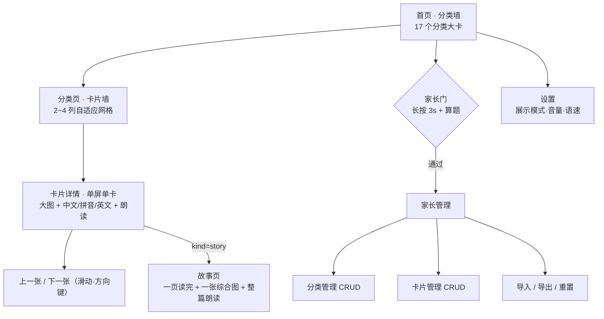

# 需求总览（FR Overview）

> 本目录存放全部**需求设计**文档。遵循 `agent/规约.md`：需求设计统一放在 `FR/` 下、按版本管理，并在本文件维护**总项目预览**与文档索引。

| 项 | 内容 |
| --- | --- |
| 产品名（暂定） | 童识 · 认知卡片 |
| 工程代号 | `early-learn` |
| 当前版本 | v0.3（故事综合图主体重做 · 与背景同族的扁平插画；一页读完 + 一张综合图；宽屏图左文右两栏、窄屏单列） |
| 交付形态 | 纯前端 Web 应用（PC / 平板 / 手机浏览器），**无后端** |
| 目标用户 | 1–3 岁幼儿的家长（使用者）+ 幼儿（观看者） |
| 内容形态 | 分类化的认知卡片：图片 + 中文 + 拼音 + 英文 + 点读发音，含汉字字卡、古诗卡与故事卡；内置 501 张卡片与 518 张脚本生成的原创插画（汉字 241 字、古诗 30 首、故事 50 本且每本 1 张综合图，17 个分类），家长可上传自己的照片替换；分类内可再按主题组筛选（汉字 7 组、古诗 2 组、故事 4 组）并分页浏览 |
| 最近更新 | 2026-10-29 |

---

## 1. 产品一句话

把「翻书认物」这件事搬到浏览器里：**按分类管理认知卡片，一张大图配中英对照与发音，家长可自己增删内容。**

## 2. 为什么做（问题与机会）

| 现状痛点 | 本产品的解法 |
| --- | --- |
| 纸质认知书内容固定，孩子认完了就闲置 | 内容可编辑、可扩展，一套壳装无限内容 |
| 图册买多了囤积占地方、找图不系统 | 分类归一管理（动物/水果/交通工具…），支持检索与导入导出 |
| 手机上东一张西一张，广告多、误点就跑偏 | 单页单卡、无广告无外链、大按钮防误触、管理入口加家长门 |
| 中英对照只能靠家长自己念，口音不统一 | 内置语音朗读（中文/英文可切），家长不必全程陪读 |
| 认汉字要另外买字卡，图与字脱节 | 汉字字卡与实物卡同一套浏览体验，字 + 拼音 + 组词 |

## 3. 目标用户与核心场景

| 用户 | 场景 | 关键诉求 |
| --- | --- | --- |
| 家长（25–40 岁，主力） | 睡前/饭后陪孩子看 5–15 分钟；周末整理孩子最近感兴趣的内容 | 打开就能用、不用注册、内容可信、能自己加 |
| 幼儿（1–3 岁） | 自己点大图看、听发音、左右滑动换卡 | 图大、按钮大、不会点退出、不弹广告 |
| 早教老师（次要，v0.2+） | 按主题准备课堂卡片 | 分类清晰、可批量导入导出 |

> 1–3 岁的核心特征决定了产品形态：**不识字、手指精度低、注意力短、会乱点**。因此界面以「图 + 大按钮 + 语音」为主，文字仅作家长辅助信息。

## 4. 核心价值主张

1. **分类即入口**：17 个主题分类，一屏看见全部主题，不埋三层菜单。
2. **一卡三读**：同一张卡同时承载 中文 / 拼音 / 英文，并可分别朗读，天然形成对照。
3. **家长可管理**：内置 501 张种子卡片，同时开放管理界面（分类与卡片 CRUD、导入导出），不依赖开发者更新。
4. **本地即存储**：数据存浏览器本地，无账号、无上传、无隐私收集，打开即用。

## 5. 信息架构

**路由草案**（技术细节见 `NFR/v0.1/技术方案.md`）

| 路由 | 页面 | 说明 |
| --- | --- | --- |
| `/` | 首页 | 分类墙 + 设置/管理入口 |
| `/c/:categoryId` | 分类页 | 该分类卡片网格 |
| `/card/:cardId` | 卡片详情 | 支持直接深链打开；故事卡带「开始阅读」 |
| `/story/:cardId` | 故事页 | 一次读完 4–8 段正文（种子 6 段）+ 1 张综合图，旧 `?page=` 链接照旧可用 |
| `/settings` | 设置 | 展示模式、语音开关与语速 |
| `/admin` | 家长管理 | 需家长门；含分类/卡片/数据三个页签 |
| `*` | 404 | 兜底返回首页 |

> 实现采用 **HashRouter**，实际地址形如 `#/card/animals-cat`（静态托管零 rewrite，取舍见 `NFR/v0.1/技术方案.md` §6）。

## 6. 版本路线图

| 版本 | 主题 | 关键能力 | 状态 |
| --- | --- | --- | --- |
| **v0.1** | MVP · 能看能管 | 分类浏览、卡片详情、中英对照 + 拼音、点读发音、家长本地管理（CRUD + 导入导出）、451 张内置卡片素材（含汉字 241 字、古诗 30 首）、分类内主题组筛选与分页 | ✅ 已实现 |
| **v0.2** | 故事绘本 | 第 17 分类「故事」：50 本故事（童话 20 / 生活习惯 15 / 情绪社交 10 / 自然认知 5）、`kind=story` + `pages[]`（正文段落）+ `moral`、独立故事页 `/story/:cardId`（一页读完、整篇朗读、Esc 返回）、每本 1 张多角色综合插图（共 50 张） | ✅ 已实现 |
| **v0.3** | 视觉一致性 | 故事综合图主体由 emoji 单色剪影改为**与背景同族的程序化扁平插画**（同色板、无描边、统一落地阴影、统一脸型），emoji 退出故事图；同版收尾：50 张逐张体检修正 18 条，实物卡 501 张与诗词 30 张封面一并换成同族画风；无功能/字段变更 | ✅ 已实现 |
| v0.4 | 学习闭环 | 收藏夹、最近浏览、「认识 / 不认识」标记、听音选图小游戏、自动播放（幻灯片）模式 | 待规划 |
| v0.5 | 内容与体验 | 汉字笔顺动画、多龄段模式（1–3 / 3–6）、拼音自动标注、PWA 离线安装 | 待规划 |
| v0.6 | 生产工具 | 批量录入（表格导入）、内置图片压缩、内容版本快照与回滚 | 待规划 |
| v1.0 | 云端协同 | 账号体系、多端同步、后端 API（替换仓储实现即可，见 NFR ADR-003） | 待规划 |

> 版本号规则：`v主.次`，主版本号变更代表**数据模型或路由契约不兼容**；次版本号代表向下兼容的功能增量或可作为一次交付验收的视觉/形态重构（不引入新功能）。v0.3 占用原规划的「学习闭环」，其余规划顺延一版。

## 7. 需求文档索引

| 文档 | 路径 | 内容 | 状态 |
| --- | --- | --- | --- |
| 需求总览 | `FR/README.md` | 产品全景、路线图、索引（本文件） | v0.3 ✅ |
| 产品需求文档 | `FR/v0.1/PRD.md` | 用户故事、功能模块、交互约束、边界异常、验收标准 | v0.1.8 已实现 |
| 内容体系与首批卡片清单 | `FR/v0.1/内容体系与首批卡片清单.md` | 16 类分类定义、451 张卡片清单（汉字 241、古诗 30）、汉字七主题组、字段填写规范、图片采集与授权规范 | v0.1.7 ✅ |
| 故事绘本需求 | `FR/v0.2/PRD-故事绘本.md` | 故事规模与配比、US-S1~S6、故事页一屏读完的交互约束、`pages`/`moral` 字段、综合图主体画风约束、边界与 DoD | v0.3 ✅ |

**技术设计索引**：见 [`NFR/README.md`](../NFR/README.md)；**Agent 协作规约**：见 [`AGENT.md`](../AGENT.md)。

## 8. 需求变更流程

1. 需求变更先改文档、后改代码，禁止「代码先行、文档补录」。
2. 同一版本的**向下兼容调整**（新增字段可选、文案调整、样式微调）→ 直接编辑当前版本文档，并在文档末尾「变更记录」追加一行。
3. **破坏性变更**（路由、数据模型、核心交互）→ 新开版本目录（如 `FR/v0.2/`），旧版本文档冻结，仅修错别字。
4. 每份需求文档必须包含：文档信息表、变更记录表、明确的「不做什么」。
5. 任何需求文档的新增/过期，必须同步更新本文件第 7 节索引。

## 9. 术语表

| 术语 | 含义 |
| --- | --- |
| 分类（Category） | 主题分组，如「动物」。含封面图、颜色、排序 |
| 卡片（Card） | 一张认知卡，是内容最小单位。`kind=object` 为实物卡，`kind=character` 为汉字字卡，`kind=poem` 为古诗卡，`kind=story` 为绘本故事 |
| 实物卡 | 真实照片 + 中/拼音/英文，如「苹果 · píng guǒ · apple」 |
| 汉字字卡 | 单字 + 拼音 + 笔画数 + 组词，如「人 · rén · 2 画 · 大人/人民」 |
| 诗词卡 | 古诗/词一首一张卡：标题 + 朝代·作者 + 按句分行的正文 + 白话译文，如「静夜思 · 唐 · 李白」；正文按句分行存储（七言一句一行、五言两句一行、词按句分行） |
| 故事卡 | 一个故事一张卡：标题 + 拼音/英文 + 寓意 + 4–8 段正文（种子统一 6 段）+ 1 张多角色综合插图，如「三只小猪」 |
| 故事页 | 故事卡专用的单页阅读页 `/story/:cardId`：一屏读完所有段落、一张综合图（点图或按钮朗读整篇）、底部寓意与返回，不翻页 |
| 点读 | 点击卡片/按钮朗读对应语言的发音 |
| 家长门 | 进入管理区的验证手势，防止幼儿误入设置 |
| 种子数据（Seed） | 随应用内置的首批分类与卡片，首次访问时写入本地存储 |
| 只读模式 | 本地存储不可用时的降级状态：可浏览种子数据，管理功能禁用 |

## 10. 变更记录

| 日期 | 版本 | 变更内容 | 作者 |
| --- | --- | --- | --- |
| 2026-10-28 | v0.1 | 首次建立需求总览：确定 1–3 岁定位、纯前端形态、v0.1 范围与路线图 | PM / Agent |
| 2026-10-28 | v0.1.1 | 实现回写：v0.1 状态改为已实现；内容形态改为「内置原创插画 + 家长可上传照片」；索引同步 PRD v0.1.1 | Agent |
| 2026-10-28 | v0.1.5 | 内容形态扩展为「汉字字卡 + 古诗卡」：新增第 16 分类「古诗」与 30 首诗词、卡片新 `kind=poem`；内容形态 361 → 391 张 / 15 → 16 分类；术语表新增「诗词卡」；索引同步 PRD v0.1.5 | Agent |
| 2026-10-29 | v0.1.6 | 汉字补齐：汉字 181 → 241 字（新增时间与数量 / 家人与五官 / 常见动物 / 交通与地点 / 反义与形容五组 60 字）；内容形态 391 → 451 张；索引同步 PRD v0.1.6 | Agent |
| 2026-10-29 | v0.1.7 | 分类页分组与分页：汉字二十组归并为七主题（数字与量 25 / 身体与家人 37 / 自然与季节 28 / 动物与植物 22 / 方位与地点 34 / 动作与形容 40 / 生活与学习 55），古诗分唐诗 / 宋词；每页 12 张、URL 可恢复；索引同步 PRD v0.1.7 | Agent |
| 2026-10-29 | v0.2 | 故事绘本大版本：① 新增第 17 分类「故事」与 50 本故事（童话 20 / 生活习惯 15 / 情绪社交 10 / 自然认知 5）；② 卡片新增 `kind=story` + `pages[]` + `moral`；③ 新增 `/story/:cardId` 故事页；④ 故事分类复用组筛选与分页，故事组 key 带 `story-` 前缀；⑤ 管理区支持故事类型（寓意 + 每段正文）；⑥ 内容形态 451 → 501 张 / 16 → 17 分类；⑦ 路线图顺延（学习闭环移至 v0.3）；⑧ 新增 `FR/v0.2/PRD-故事绘本.md` | Agent |
| 2026-10-29 | v0.2.2 | 需求方反馈「故事在一页，配一个综合的图就行」：① 取消逐页翻页与页码，`pages[]` 由「页」改作「正文段落」，故事页一屏读完；② 每本只保留 1 张多角色同场景综合图（脚本按首段场景 + 全书主体计数聚合），删掉 300 张分页插图；③ 故事插图 350 → 50 张、全站 818 → 518 张；④ `pages[].image` 降为可选（旧数据与旧 `?page=` 链接兼容）；⑤ 详情按钮「翻开故事」→「开始阅读」、列表角标「绘本 · 6 页」→「绘本故事」；⑥ 新增 ADR-S7 记录该形态决策 | Agent |
| 2026-10-29 | v0.2.3 | 需求方反馈「配图和屏幕占比不对」：① 故事页屏幕适配拆为两档——宽屏（≥780px 且高 ≥520px）图左文右两栏、图占满左栏、正文/寓意/按钮同屏；窄屏单列、图满宽居中；② 删除综合图 `max-height: 42vh` 限高，改严格 4:3，两侧不再露分类色；③ 综合图主体改「角色优先于道具」聚合，三只小猪恢复「猪 + 狼 + 砖房」；④ US-S3 验收标准同步改写 | Agent |
| 2026-10-29 | v0.3 | 需求方反馈「这个背景挺好，但是配图狼、猪、房子太不协调，其他配图也一样，能不能像背景一样」：① 综合图主体由 emoji 单色剪影改为**与背景同色板的程序化扁平插画**（9 个画师 + 98 个主体规格），emoji 退出故事图；② 主体加统一落地阴影、收敛比例与耳/尾/发型，去掉「贴纸白晕」；③ 主体与背景同处一条落脚线（地面/飞行/水中/天空分档），水中生物沉入水面以下；④ 无功能变更，`Card` 字段与路由契约不变；⑤ 故事图 50 张 260.5 → 199.0 KB；⑥ 新增 `NFR/v0.3/技术方案-主体插画.md`，路线图「学习闭环」仍留待后续版本 | Agent |
| 2026-10-29 | v0.3.0（收尾） | 需求方「50 张拼缩略图逐张检查、列问题清单并逐条修；有些很虚影，其他分类也换成故事那种风格」：① 50 张按「协调性/悬空/沉底/比例/配色」逐张体检，修 18 条（夜景与洞穴地平线、两个月亮、同画师主角被误去重导致龟兔只剩兔、丑小鸭只剩天鹅、三只小猪没狼）；② 实物卡 501 张不再用 emoji 剪影，统一「渐变天 + 地面带 + 彩色扁平主体」，与故事图同族；③ 诗词 30 张封面重写为「宣纸底 + 墨色三层景」，不再 8 张雷同；④ 新增视觉硬约束：主体须在 300px 缩略图下可辨识（< 3px 描线会消失），全站不得回退 emoji/单色剪影；⑤ 索引同步 PRD v0.3 ✅ | Agent |
| 2026-10-29 | v0.3.1 | 需求方「动物的配图识别度太不高了，小孩看着感觉都是一个」：① 22 张动物卡从「同一模板换色」改为「剪影可分辨」——体型 5 档 / 腿长 3 档 / 吻部 / 项圈·门牙·猫须·白袜·马蹄·小角等身份件，猫耳与垂耳分开；② 象 / 马 / 长颈鹿改侧身画法（灰老鼠 / 戴围脖的熊 / 台灯不再出现）；③ 老虎改横向条纹、蝴蝶放大；④ 新增需求约束「同模板主体必须有轮廓差异」（见「PRD-故事绘本」§3 与 DoD） | Agent |
| 2026-10-29 | v0.3.2 | 补上 v0.3.1 未覆盖的一块：马在故事图里腿偏长（与同框兽类、人物比失衡）。新增需求约束「同框比例」——同一画面共用地面线，腿身/头身比必须落在同一档位区间且四肢不得脱离躯干（见「PRD-故事绘本」§3 与 DoD）；图已全量重出并逐张复核 | Agent |
| 2026-10-30 | v0.3.3 | 点读发音补上“不得静默失败”一条：需求方反馈「英语按钮点击没有声音」（应用已部署到服务器，客户端不可控），而原需求只写了“无 voice 时禁用并提示”，没覆盖“有 voice 但出不来声”这一类。新增 US-04 两条验收（网络音色连不通时优先本地音色、最多试 3 个，仍无声必须 Toast 说出原因；设置页要能看到本机音色探测结果）与 M4 / §5.5 对应行 | Agent |
