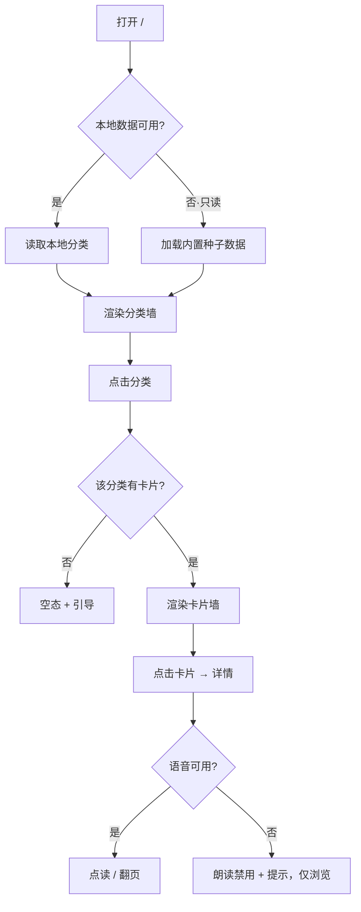
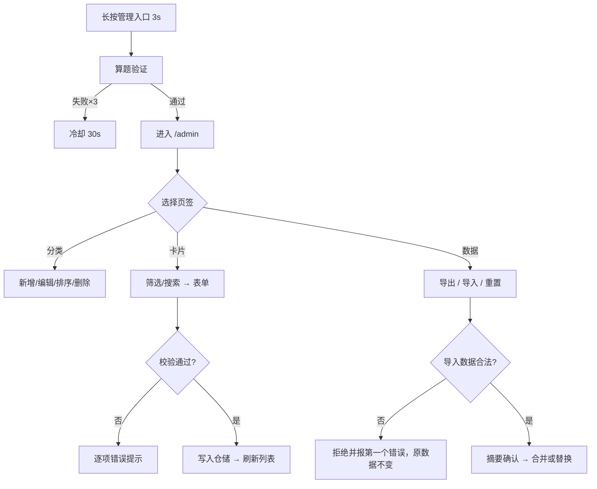
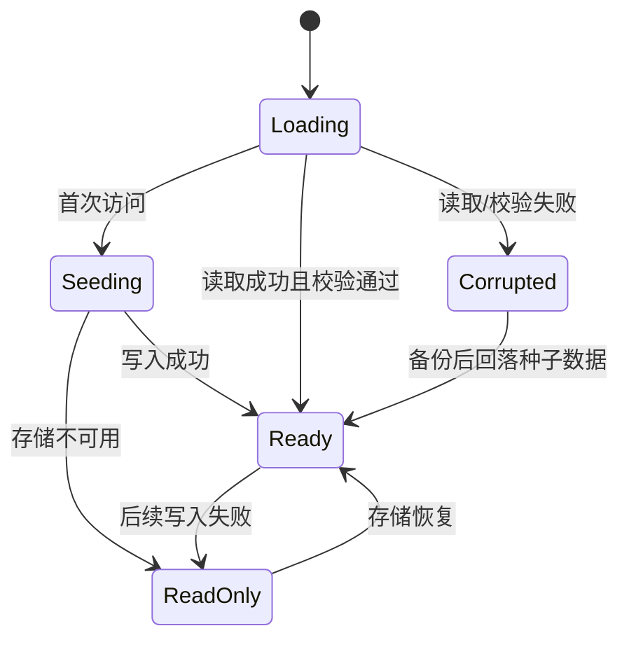

# PRD · 童识认知卡片 v0.1（MVP）

| 项 | 内容 |
| --- | --- |
| 文档版本 | v0.1.8 |
| 状态 | **已实现**（T1–T17）+ v0.1.2 内容扩充与详情页布局修复 + v0.1.3 内容广度扩充 + v0.1.4 汉字收尾 + v0.1.5 诗词卡（古诗 30 首）+ v0.1.6 汉字扩容（241 字）+ v0.1.7 分类页分组与分页；四道自动门禁 + 内容门禁全绿；设备矩阵待真机验收 |
| 关联文档 | `FR/README.md`（总览）、`FR/v0.1/内容体系与首批卡片清单.md`、`NFR/v0.1/技术方案.md`；故事绘本见 `FR/v0.2/PRD-故事绘本.md` |
| 交付形态 | 纯前端 Web（React + TypeScript），无后端、无账号、数据存浏览器本地 |
| 目标设备 | 平板（主）> 手机 > 桌面 |
| 更新日期 | 2026-10-29 |

## 变更记录

| 日期 | 版本 | 变更内容 |
| --- | --- | --- |
| 2026-10-28 | v0.1.0 | 首次成稿：确定 1–3 岁启蒙定位、P0 范围（浏览 + 详情 + 本地管理）、交互与边界约束 |
| 2026-10-28 | v0.1.1 | 实现回写：状态改为已实现；图片口径由「真实照片」调整为「内置脚本生成的统一风格插画」（零授权、零 404，保留同名同路径替换实拍的升级路径）；第 12 节 DoD 按实测结果勾选 |
| 2026-10-28 | v0.1.2 | 实物反馈回写：① 重写详情页布局（图片区不再被压成 0 高，正方形取可用宽高较小值，矮屏改滚动保底）；② 内容扩充到 196 张（汉字 15→76，补英语词汇 22 张）；③ 增加「内置内容版本」增量升级，老数据自动补齐新卡 |
| 2026-10-28 | v0.1.3 | 内容广度扩充：① 汉字 76 → **151 字**（新增五组：方位与距离 / 家人与称呼 / 动作 / 生活用品与衣物 / 自然与季节，重点补齐上下左右中、你我他、爸妈爷奶兄弟姊妹、走跑跳、红黄蓝绿、春夏秋冬）；② 新增 **5 个英语主题分类**（家人 Family / 天气 Weather / 动作 Verbs / 食物 Food / 学校用品 School）共 60 词；③ 总量 196 → **331 张 / 15 分类**；④ 新增 5 个分类主色 token（`rose`/`cloud`/`lime`/`apricot`/`violet`）；⑤ `SEED_VERSION` 2→3 |
| 2026-10-28 | v0.1.4 | 汉字收尾：151 → **181 字**（新增第十四组饮食与味道、第十五组学习与常用，各 15 字）；总量 331 → **361 张 / 15 分类**；图片 376 个 WebP / 1.1MB；`SEED_VERSION` 3→4 |
| 2026-10-28 | v0.1.5 | 内容形态扩展 · 诗词卡：① 卡片 `kind` 新增 `poem`，附件字段 `author` / `dynasty` / `lines[]` / `translation`（均可选，老数据无需迁移）；② 新增分类**古诗**（`poems`，第 16 类，宣纸主色 `xuan`）；③ 内置 **30 首**（唐诗 20 + 宋词 10），正文按句分行、附白话译文；④ 详情页诗词分支（标题 / 朝代·作者 / 分行正文 / 译文）与「读全诗」；⑤ 管理区表单支持古诗词类型与 4 个专属字段；⑥ 总量 361 → **391 张 / 16 分类**；图片 407 个 WebP / 1.14MB；`SEED_VERSION` 4→5 |
| 2026-10-29 | v0.1.6 | 汉字扩容：181 → **241 字**（新增五组：时间与数量 年今早晚午/百千万/个只条把件双半、家人与五官 父母/眼鼻嘴牙舌/脚腿指背身、常见动物 鸡鸭鹅猫狗猪兔虎狮象鹿鼠、交通与地点 船飞机/路桥街城乡湖江沙、反义与形容 长短快慢冷热新旧美丑）；总量 391 → **451 张 / 16 分类**；图片 467 个 WebP / 1.35MB；`SEED_VERSION` 5→6 |
| 2026-10-29 | v0.1.7 | 浏览体验：分类内**主题组筛选**（汉字二十组归并为七组：数字与量 25 / 身体与家人 37 / 自然与季节 28 / 动物与植物 22 / 方位与地点 34 / 动作与形容 40 / 生活与学习 55；古诗分唐诗 20 / 宋词 10）+ **每页 12 张分页**（>12 张才出现，URL 带 `?group=&page=`）；详情页按同一组内序列翻页、返回回到原页；分组归属不写入卡片数据（老数据零迁移） |
| 2026-10-29 | v0.1.8 | 交叉引用同步（不动 v0.1 需求本身）：v0.2 实际交付为「故事绘本」，路线图顺延，因此第 11 节「计划版本」与第 2 节画像版本号改为 v0.3+；关联文档补 `FR/v0.2/PRD-故事绘本.md` |

---

## 1. 需求概览

### 1.1 背景

家长常见的早教方式是买认知图册：一页一图，配中文名与英文名，反复指认。痛点在于内容固定、买多了占地、无法按孩子的兴趣动态扩展；而手机上的同类 App 又普遍广告多、外链多、误触即跑偏。

本项目把这件事做成一个**家长可维护的 Web 认知卡片库**：分类管理内容，一张卡片同时承载图片、中文、拼音、英文与发音，并支持汉字字卡。**v0.1 不做后端**，数据落在浏览器本地，保证零门槛、零隐私风险。

### 1.2 核心目标

| 目标 | 衡量方式 |
| --- | --- |
| G1 孩子能独立使用（无需家长操作） | 从首页到看卡不超过 2 次点击；所有主操作触控目标 ≥ 88px |
| G2 一屏完成「图—声—词」三联认知 | 详情页单屏内同时可见图、中文、拼音、英文，可分别朗读 |
| G3 家长能自己维护内容 | 不写代码即可完成 分类新增 / 卡片新增与编辑 / 数据导出备份 |
| G4 内容可信、可用 | 内置 ≥ 450 张卡片，覆盖 16 个分类，图片无 404（内置素材为脚本生成的原创插画，见 1.4 图片口径） |

### 1.3 成功指标（v0.1 验收期）

| 指标 | 目标值 |
| --- | --- |
| 首屏可交互时间（4G、中端安卓平板） | ≤ 2.5s（LCP） |
| 卡片详情打开耗时（同设备） | ≤ 300ms |
| 图片缺失导致的空白卡 | 0（必须走占位兜底） |
| 家长完成「新增一张卡片」所需操作 | ≤ 8 步 |
| 关键流程自动化测试覆盖 | 领域层 ≥ 80%，页面主要路径 100% 覆盖 |

### 1.4 v0.1 范围

**做**：分类浏览、卡片墙、卡片详情（图 + 中文 + 拼音 + 英文 + 点读）、上下张切换、展示模式（中/英/对照）、家长门、分类与卡片 CRUD、数据导入/导出/重置、降级兜底、451 张内置卡片素材（含汉字 241 字、古诗 30 首）。

> **内容广度（v0.1.2 调整）**：需求方反馈「汉字太少、1–10 岁孩子需要更多汉字和英语」，内容从 113 张扩到 **196 张**：汉字 15 → **76 字**（数字/人体/自然/动植物/方位/家人动作/颜色/常用字八组，每字带拼音、英文、笔画与两个组词），并增补 **22 个英语词汇**（狮子、长颈鹿、青蛙、蝴蝶、椰子、猕猴桃、西兰花、救火车…）。卡片 `difficulty` 1–3 分层支撑：1–3 岁先认图、4–6 岁认字、7–10 岁中英对照巩固。

> **内容广度（v0.1.3 再扩）**：需求方要求继续扩充。汉字 76 → **151 字**，新增五组：方位与距离（左/右/前/后/里/外/东南西北/近/远/边/间/回）、家人与称呼（哥/弟/姐/妹/爷/奶/她/子/儿/男/友/朋/爱/亲/老）、动作（跳/抱/笑/哭/睡/起/站/拿/放/开/关/写/画/唱/玩）、生活用品与衣物（衣/鞋/帽/床/灯/桌/椅/碗/筷/洗/穿/脱/房/窗/园）、自然与季节（绿/春/夏/秋/冬/雪/雷/星/光/海/河/土/林/叶/果）；英语新增 5 个主题分类各 12 词共 **60 词**。总量 **331 张 / 15 分类**。

> **内容形态（v0.1.5 扩展 · 诗词卡）**：需求方要求加入「唐诗三百首 / 宋词三百首」。全量 600 首对纯前端包的体积、校对成本与幼儿屏幕时长都不成比例，因此按**精选 30 首**（唐诗 20 + 宋词 10）先验证形态：复用卡片详情页，新增第 16 个分类「古诗」，卡片扩展 `kind=poem` + 作者 / 朝代 / 分行正文 / 白话译文 4 个字段。总量 **391 张 / 16 分类**。全量收录列入第 11 节「明确不做」（评估中），形态跑通后可只加种子数据、不改代码。

> **内容广度（v0.1.6 再扩 · 汉字补齐）**：按「孩子最早会说的具体字」补齐 60 字——时间与数量（年/今/早/晚/午/百/千/万/个/只/条/把/件/双/半）、家人与五官（父/母/眼/鼻/嘴/牙/舌/脚/腿/指/背/身）、常见动物（鸡/鸭/鹅/猫/狗/猪/兔/虎/狮/象/鹿/鼠）、交通与地点（船/飞/机/路/桥/街/城/乡/湖/江/沙）、反义与形容（长/短/快/慢/冷/热/新/旧/美/丑）。汉字 181 → **241 字**，总量 **451 张 / 16 分类**。字形卡与分类里的「词卡」（如字卡「眼」与身体部位词卡「眼睛」）分属认字与认物两个层级，允许同源重复。

> **浏览体验（v0.1.7 · 分类内分组 + 分页）**：汉字 241 张一条长列表滑不完，孩子找不到上次看的那张。因此分类页增加**主题组筛选**（汉字：把源码里二十个学习组归并为七个主题；古诗：唐诗 / 宋词）与**每页 12 张分页**（平板 4 列 × 3 行，一屏看完）。分类内卡片数 ≤ 12 时不出现分页，组数 ≤ 1 时不出现筛选条，小分类保持原样。分组归属存在 `src/data/seed/characterGroups.ts`、不写入卡片数据，因此老用户数据零迁移，家长自建卡自动落在「未分组」。列表位置写进 URL（`?group=nature&page=2`），详情页只在当前组内翻页，返回时回到原页。

> **图片口径（v0.1.1 调整）**：原定「真实照片 + 授权登记」改为**内置脚本生成的统一风格扁平插画**（SVG → WebP），原因：纯前端 v0.1 无法承担实拍的取材与授权成本，而需求方无自有素材。生成素材为项目原创、无第三方授权风险，且沿用同一路径规范，后续把实拍/AI 图**同名同路径覆盖**即可完成升级，无需改代码。管理区上传功能仍走真实图片链路。

**不做**（见第 11 节详细说明）：账号与云同步、收藏/学习记录、小游戏测验、汉字笔顺动画、多龄段模式、社交分享、付费。

---

## 2. 用户画像与典型场景

### 2.1 画像

| 画像 | 描述 | 关键约束 |
| --- | --- | --- |
| 家长 A（主） | 32 岁，孩子 2 岁半。用 iPad 陪看，每天 10 分钟 | 不想注册、不想看广告、希望自己加「挖掘机」「恐龙」这类孩子偏爱的词 |
| 幼儿 B | 2 岁半，不识字，爱乱点、爱反复听同一个词 | 手指大范围点、会连点、会横滑；需要即时反馈与音效 |
| 老师 C（v0.3 起） | 早教机构，按周主题备课 | 需要按主题筛选、批量导入 |

### 2.2 关键场景（Happy Path）

1. **日常陪看**：家长打开 `/` → 点「动物」→ 点「猫」→ 自动朗读「猫」→ 家长点英文按钮听「cat」→ 手指左滑到下一张。
2. **孩子自主**：孩子自己点分类 → 点任意图 → 连点图片反复听发音（无副作用，不会跳走）。
3. **家长加词**：孩子迷上恐龙 → 家长进家长门 → 卡片管理 → 新增「恐龙」→ 填中/拼/英、上传照片 → 保存 → 返回首页可见。
4. **换设备备份**：导出 JSON 文件 → 在另一台平板导入 → 内容一致。

---

## 3. 用户故事与验收标准

### US-01 浏览分类（P0）

作为家长，我希望在首页看到全部主题分类，以便孩子直接选出感兴趣的一类。

- Given 应用已加载种子数据，When 打开 `/`，Then 以网格展示全部分类，每张含封面图、中英文名、卡片数量。
- Given 某分类下无卡片，When 展示该分类，Then 显示「0 张」且点击后进入空态页（不是空白）。
- Given 屏幕宽 360px，When 渲染首页，Then 单列/双列自适应，无横向滚动。

### US-02 查看分类下的卡片墙（P0）

作为幼儿，我希望点一个分类就看到里面所有图，以便一张张认。

- Given 已进入 `/c/animals`，When 渲染完成，Then 以 2/3/4 列自适应网格展示该分类第一页的 12 张卡片缩略图与中文名。
- Given 分类卡片数 > 12，Then 底部分页条显示「第 x / y 页」与「上一页 / 下一页」，首末页对应按钮禁用；点击翻页回到列表顶部。
- Given 该分类存在两个以上主题组（汉字 7 组、古诗 2 组），Then 顶部显示组筛选条，点「自然与季节」只显示该组，卡片数与页数同步更新，并回到第 1 页。
- Given 刷新页面或分享链接，Then 当前分组与页码由 URL（`?group=nature&page=2`）恢复；参数非法（不存在的组、越界页码）时回退到全部 / 第 1 页。
- Given 卡片数 > 12，When 滚动到底部，Then 图片按需加载（懒加载），不出现长时间白块。
- Given 直接访问 `/c/not-exist`，When 路由解析，Then 展示「分类不存在」空态，含返回首页按钮。

### US-03 查看卡片详情（P0）

作为家长，我希望点开一张卡就能看到大图与中英对照，以便指认与讲解。

- Given 在卡片墙点击「苹果」，When 进入 `/card/a-apple`，Then 单屏展示：大图（占比 ≥ 50% 视口高）、中文「苹果」、拼音「píng guǒ」、英文「apple」。
- Given 展示模式为「中文」，Then 仅显示中文与拼音（英文区隐藏但保留占位，避免布局跳动）。
- Given 展示模式为「对照」，Then 中英同屏，中文在上（主）、英文在下（次）。
- Given 图片加载失败，Then 显示首字占位块（如「苹」）+ 分类色底，其余信息正常展示。
- Given 打开诗词卡（如「静夜思」），Then 展示：标题 → 朝代·作者（「唐 · 李白」）→ 按句分行的正文 → 白话译文；朗读按钮文案为「读全诗」，朗读内容为整首正文而非标题。

### US-04 点读发音（P0）

作为幼儿，我希望点图片/喇叭就能听到这个词怎么念。

- Given 浏览器支持中文语音，When 点击图片或「🔊 中文」按钮，Then 朗读当前中文字段，并给出朗读中的视觉反馈。
- Given 点击「🔊 English」，Then 朗读英文字段。
- Given 连续快速点击 5 次，Then 取消上一次朗读、只朗读最后一次，不产生叠音。
- Given 浏览器无可用语音（无 `speechSynthesis` 或无对应语言 voice），Then 朗读按钮呈禁用态，且首次进入详情页时 Toast 提示「当前浏览器不支持发音，建议使用 Chrome / Edge / Safari」。
- Given 该语言只有网络音色（连不上厂商服务器就发不出声），When 点击朗读，Then 优先用本地音色、最多试 3 个，全部没出声时 Toast 说明具体原因与处置建议——**不允许「点了什么反应都没有」**（v0.3.3）。
- Given 打开设置页的「语音朗读」，Then 能看到「本机音色：中文 N 个（本地 M 个）· 英文 N 个（本地 M 个）」，英文为 0 时附一句「在系统语音设置里加装本地英文语音」——应用部署到服务器后，这是家长自查的唯一手段（v0.3.3）。

### US-05 上下张切换（P0）

作为幼儿，我希望左右滑动就能看下一张，不用退回列表。

- Given 在详情页，When 手指左滑（或按 → / 点击「下一张」），Then 切换到同分类下一张卡片，并保留当前展示模式。
- Given 当前已是最后一张，When 继续下一张，Then 停在最后一张并给出轻微提示（不循环、不跳回首页）。
- Given 从卡片墙进入详情（第 5 张），When 查看，Then 「上一张/下一张」基于分类内排序上下文，而非全局顺序。
- Given 从某个主题组（如「自然与季节」）进入详情，Then 上下张只在该组内移动，不串到其它组；点返回回到原来的分组与页码。

### US-06 切换展示模式（P0）

作为家长，我希望切换「中文 / 英文 / 中英对照」，以便分阶段教学。

- Given 在设置或详情页切换为「英文」，When 返回任意卡片，Then 主显示英文、隐藏中文（拼音区域隐藏）。
- Given 刷新页面后重新打开，Then 展示模式被记住（本地持久化）。
- Given 选择「对照」，Then 中英文同屏显示，字号中文 > 英文。

### US-07 家长门（P0）

作为家长，我希望管理入口有验证，以免孩子误入设置删掉内容。

- Given 在首页长按「设置/管理」按钮 < 3s，When 松手，Then 不进入并提示「请长按 3 秒」。
- Given 长按满 3s，When 弹出一道 10 以内加减法，Then 答对方可进入 `/admin`。
- Given 答错，Then 可重试，连续 3 次错误则关闭弹窗并冷却 30s。

### US-08 分类管理（P0）

作为家长，我希望新增/重命名/排序/删除分类，以便按孩子兴趣组织内容。

- Given 在分类管理点「新增」，When 填写名称（必填）、英文名（可选）、选主色、上传封面（可选），Then 保存成功并出现在首页末尾。
- Given 分类名与已有分类重复，When 保存，Then 拒绝并提示「分类名已存在」。
- Given 删除一个含卡片的分类，When 确认，Then 二次确认弹窗明确写出「将同时删除 N 张卡片」，确认后级联删除。
- Given 调整排序，Then 首页与分类管理顺序一致，刷新后保持。

### US-09 卡片管理（P0）

作为家长，我希望新增与编辑卡片内容，以便补充孩子感兴趣的词。

- Given 新增卡片，When 必填项（中文名、分类、图片）任一为空，Then 保存按钮禁用并逐项提示。
- Given 填写中文「恐龙」、拼音「kǒng lóng」、英文「dinosaur」，When 保存，Then 卡片出现在对应分类末尾，且可直接深链打开。
- Given 上传图片 > 500KB，When 保存，Then 拒绝并提示压缩后重试（v0.1 不做自动压缩）。
- Given 编辑已有卡片，When 修改中文名，Then 拼音不自动覆盖（避免错误拼写），由家长手动维护。
- Given 选择类型「汉字字卡」，Then 表单额外显示：笔画数（1–30）、组词（≤3 个）、部首（可选）。
- Given 选择类型「古诗词」，Then 表单额外显示：作者、朝代、正文（每行一句）、白话译文；标题上限放宽到 20 字以容纳词牌与副题；切换类型时若当前分类不合法，自动指向「古诗」。

### US-10 数据导入 / 导出 / 重置（P0）

作为家长，我希望备份并迁移我的内容。

- Given 点击「导出」，Then 下载一个 JSON 文件，含 `schemaVersion`、导出时间、全部分类与卡片。
- Given 导入一个合法 JSON，Then 提供「合并（按 id 覆盖）/ 替换全部」两种模式，导入前展示数量摘要。
- Given 导入非法 JSON（结构错误、字段缺失），Then 拒绝并指出第一个错误位置，不破坏现有数据。
- Given 点击「重置为内置内容」，Then 二次确认后清除本地数据并重新写入种子数据。

### US-11 只读降级（P0）

作为用户，我希望浏览器限制本地存储时仍能正常看卡。

- Given localStorage 不可用（隐私模式或配额为 0），When 打开应用，Then 以只读模式加载内置种子数据，全站可浏览可发音。
- Given 只读模式，When 点击管理入口，Then 提示「当前浏览器无法保存数据，管理功能不可用」并禁止进入。
- Given 保存时抛出配额超限，Then 提示「存储空间已满，请先导出备份并删除部分卡片」，本次保存不生效。

---

## 4. 功能模块清单

| 编号 | 模块 | 描述 | 优先级 | 复杂度 | 依赖 | 验收标准 |
| --- | --- | --- | --- | --- | --- | --- |
| M1 | 分类墙（首页） | 16 类网格、封面、数量、排序 | P0 | 低 | 分类数据 | 全部分类可见、空分类有标识、自适应网格 |
| M2 | 卡片墙 | 分类内网格、主题组筛选、每页 12 张分页、懒加载、缩略图 | P0 | 中 | M1、卡片数据 | 一屏不滚动、翻页不丢位置、组内筛选即时生效 |
| M3 | 卡片详情 | 单屏单卡、中/拼/英、模式切换、上下张；诗词卡单独排版 | P0 | 中 | M2 | 单屏优先、矮屏可滚动保底、模式记忆、边界不 looping |
| M4 | 点读发音 | 中/英分语种朗读、连点取消、降级 | P0 | 中 | 浏览器 Speech API | 连点不叠音、无 voice 时禁用并提示、**朗读没出声时必须说出原因（不得静默失败）** |
| M5 | 家长门 | 长按 3s + 算题 + 错误冷却 | P0 | 低 | 无 | 未通过不可进管理区 |
| M6 | 分类管理 | 新增/编辑/排序/删除 | P0 | 中 | M5 | 重名拦截、级联删除二次确认 |
| M7 | 卡片管理 | 列表（按分类筛选/搜索）+ 表单 CRUD + 图片选择 | P0 | 高 | M5、M6 | 表单校验完整、图片体积限制生效 |
| M8 | 数据管理 | 导出 JSON / 导入（合并·替换）/ 重置 | P0 | 中 | M6、M7 | 导入前摘要、非法数据不破坏现状 |
| M9 | 设置 | 展示模式、语音开关、语速（0.6–1.2）、减少动效 | P0 | 低 | 无 | 设置持久化、跟随系统减少动效 |
| M10 | 降级与兜底 | 只读模式、配额超限、数据损坏恢复、图片占位、404 | P0 | 中 | 全部 | 各降级路径有明确提示且不白屏 |
| M11 | 内容素材 | 451 张卡片内置素材（汉字 241、古诗 30）、授权登记 | P0 | 高（工作量） | 图片来源 | 每张图片可溯源、无 404 |
| M12 | 搜索（家长向） | 管理页按 中文/英文/拼音 搜索 | P1 | 低 | M7 | 支持中文与英文子串匹配 |

> P0 = v0.1 必须交付；P1 = v0.1 尽量交付（工作量不足时顺延 v0.2）。

---

## 5. 详细功能说明

### 5.1 首页 · 分类墙

- 布局：`clamp(2, 视口/220px, 4)` 列；每张分类卡为 4:3 或 1:1 封面 + 名称（中文 20–24px，英文 14–16px）+ 数量角标。
- 排序：`sortOrder` 升序；新增分类追加到末尾。
- 入口：右下/右上固定「设置」按钮（触控区 88×88），长按触发家长门；短按进入幼儿可见的展示模式快捷切换（仅「中/英/对照」三项，无删除类操作）。
- 空态：仅当全部分类为空时显示「还没有分类」+「进入管理创建」（需家长门）。

### 5.2 分类页 · 卡片墙

- 卡片块：1:1 图片 + 中文名（16–20px）；缩略图 320px 档。
- 列数：360px → 2 列；≥ 640px → 3 列；≥ 1024px → 4 列。
- 点击行为：图片或名称均可点，进入详情并携带「分类上下文 + 索引」。
- 面包屑：仅一个返回按钮（88×88），不做多层文字导航。

### 5.3 卡片详情

- 结构（自上而下，单屏优先）：返回 · 大图（可点读，永远为正方形，边长 = 可用宽高较小值）→ 中文（大字）→ 拼音（中等，带声调）→ 英文（中号）→ 底部工具条（🔊中文 / 🔊English / 上一张 / 下一张 / 页码）。
- 高度分配（v0.1.2 修正）：图片区 `flex: 1` 吃掉剩余高度且 `min-height: 220px`；「文字 + 按钮」高度不够时改**纵向滚动**，绝不把图片压成 0 高；读词按钮与翻页按钮分两行，不换行错位。
- 手势：左滑下一张、右滑上一张；键盘 ← → 可用。
- 自动朗读：**默认不自动播放**（避免突然出声吓到孩子），由家长在设置中开启「进入即朗读中文」。
- 汉字字卡：主视觉为汉字字形（大字号，可用书法体字形图或纯文字渲染），辅助显示拼音、笔画数、组词；不显示物理照片。
- 诗词卡（v0.1.5）：主视觉为水墨意境图（上限 36dvh，避免挤掉正文），下方依次为 标题（20–30px）→ 朝代·作者（13px 次要色）→ 分行正文（楷体，16–23px，行高 1.62）→ 白话译文（13px）。正文按句分行不折行：七言每行一句、五言每行两句、词按句分行。英文模式不显示诗词正文（译本差异大，避免误导），仅显示英文标题。

### 5.4 家长管理

| 页签 | 能力 |
| --- | --- |
| 分类 | 列表（拖拽或上下移排序）、新增、编辑（名称/英文/主色/封面）、删除（级联提示） |
| 卡片 | 按分类筛选 + 搜索（中文/英文/拼音）；列表显示缩略图、中文、分类、更新时间；新增/编辑/删除 |
| 数据 | 导出 JSON、导入 JSON（合并/替换）、重置为内置内容、查看存储占用 |

**卡片表单字段**（校验规则见 6.1）：类型（实物/汉字/古诗词）、分类、中文名（诗词卡为「标题」）、拼音、英文、音标（可选）、图片（必填）、标签（≤5）、难度（1–3）、来源与授权（导入时必填，手动新增时可选）；选「古诗词」时额外显示作者 / 朝代 / 正文 / 白话译文，且 4 项均必填。

### 5.5 设置

| 设置项 | 取值 | 默认 | 作用范围 |
| --- | --- | --- | --- |
| 展示模式 | 中文 / 英文 / 中英对照 | 中文 | 详情页与卡片墙文字 |
| 语音开关 | 开 / 关 | 开 | 全站朗读按钮可用性 |
| 语速 | 0.6 / 0.8 / 1.0 / 1.2 | 0.8 | TTS 播放速率 |
| 进入即朗读 | 开 / 关 | 关 | 详情页进入时朗读中文 |
| 减少动效 | 跟随系统 / 强制开启 | 跟随系统 | 关闭页面转场与缩放动画 |
| 本机音色 | 只读展示 | — | 中文/英文各有几个音色、其中几个本地；用于判断「点了没声音」是环境还是代码（v0.3.3） |
| 恢复默认 | 按钮 | — | 仅重置设置，不动内容 |

---

## 6. 内容与数据规范

### 6.1 卡片字段校验

| 字段 | 类型 | 必填 | 校验规则 |
| --- | --- | --- | --- |
| `id` | string | 是 | 系统生成，`{分类前缀}-{slug}` 或 UUID；全局唯一，不可编辑 |
| `kind` | enum | 是 | `object` \| `character` \| `poem` |
| `categoryId` | string | 是 | 必须指向存在的分类 |
| `zh` | string | 是 | 1–8 个字符；汉字字卡时长度必须为 1；诗词卡为标题（含词牌与副题），上限 20 |
| `pinyin` | string | 是 | 小写带声调，音节间用空格分隔（`píng guǒ`） |
| `en` | string | 是 | ≤ 3 个单词，首字母小写（专有名词除外） |
| `phonetic` | string | 否 | IPA，含首尾 `/`，如 `/ˈæpl/` |
| `image` | string | 是 | 站内相对路径（`/assets/images/...`）或 `data:image/*`；单张 ≤ 500KB |
| `tags` | string[] | 否 | ≤ 5 个，单个 ≤ 8 字 |
| `difficulty` | 1\|2\|3 | 是 | 默认 1（1=最基础） |
| `strokes` | number | 汉字必填 | 1–30 |
| `words` | string[] | 否 | ≤ 3 个组词，每个 ≤ 4 字 |
| `radical` | string | 否 | 部首，1 个字 |
| `author` | string | 诗词必填 | 作者，≤ 12 字 |
| `dynasty` | string | 诗词必填 | 朝代，≤ 6 字（如「唐」「南宋」） |
| `lines` | string[] | 诗词必填 | 按句分行，2–8 行，每行 1–14 字；七言一句一行、五言两句一行 |
| `translation` | string | 诗词必填 | 白话译文，≤ 90 字 |
| `source` | object | 否 | `{ provider, author?, url?, license }`，图片授权溯源 |
| `createdAt` / `updatedAt` | ISO string | 是 | 系统写入 |

### 6.2 分类字段校验

| 字段 | 规则 |
| --- | --- |
| `id` | 英文小写短横线，全局唯一 |
| `name` | 1–12 字，全局唯一（重名拒绝） |
| `nameEn` | 可选，≤ 24 字符 |
| `color` | 预设色板中的 token（16 选 1），保证对比度 |
| `cover` | 可选，缺失时用分类中文首字 + 主色块 |
| `sortOrder` | 整数，升序，允许并列（同值时按创建时间） |

### 6.3 数据一致性约束

1. 删除分类时，其下卡片级联删除（必须二次确认，提示受影响数量）。
2. 卡片 `categoryId` 必须存在，否则视为脏数据，在加载时归入「未分类」并提示家长修复。
3. `id` 冲突时（导入合并）按「新覆盖旧」处理，但保留 `createdAt` 原值。
4. 拼音不做自动生成：拼音错误比没有拼音更糟，v0.1 一律手动录入。

---

## 7. 交互与视觉约束（1–3 岁专项）

| 维度 | 约束 | 理由 |
| --- | --- | --- |
| 触控目标 | 主操作 ≥ 96×96px；次操作 ≥ 88×88px；间距 ≥ 16px | 幼儿手指定位误差大 |
| 字号 | 详情中文 72–96px；卡片墙中文 16–20px；拼音 24–28px；英文 32–40px；家长管理正文 ≥ 16px | 远距离观看 + 家长可读 |
| 颜色 | 主色低饱和高明度；正文对比度 ≥ 4.5:1；不使用纯红/纯绿区分状态 | 避免视觉疲劳与色盲歧义 |
| 动画 | 单次 ≤ 200ms，仅位移/透明度；禁止闪烁、抖动、循环动画 | 防止过度刺激 |
| 反馈 | 每次点击必有反馈（按压态 + 可选短音效），音效可关 | 建立因果认知 |
| 导航 | 全站最多一层返回；不出现底部多层 Tab | 降低迷失 |
| 防误触 | 管理入口需家长门；删除类操作不在幼儿可见页面出现；双击不缩放 | 避免误删/误跳 |
| 内容安全 | 无广告、无外链跳转、无社交分享、无输入框暴露给幼儿 | 儿童使用安全 |
| 音量 | 默认语速 0.8，不自动播放（除非家长开启） | 避免惊吓 |

---

## 8. 边界条件与异常场景

| 场景 | 触发条件 | 期望行为 |
| --- | --- | --- |
| 空分类 | 分类下 0 张卡片 | 空态插画 + 「去添加卡片」（家长门） |
| 全空数据 | 删除所有分类 | 首页空态引导，不白屏 |
| 图片 404 | 资源缺失/路径错误 | `ImageWithFallback` 显示首字 + 分类色，控制台告警（开发态） |
| localStorage 禁用 | 隐私模式 / 策略禁止 | 只读模式 + 顶部常驻提示条 |
| 配额超限 | 保存时 `QuotaExceededError` | 阻断保存，提示导出备份并删除内容 |
| 数据损坏 | JSON 解析失败 / schema 校验失败 | 备份损坏数据到 `:corrupted` key，回落种子数据，提示「已恢复内置内容，原数据已备份」 |
| 深链失效 | `/card/:id` 或 `/c/:id` 不存在 | 404 空态 + 返回首页，不重定向循环 |
| 多标签页并发编辑 | 另一标签写入 | 监听 `storage` 事件，提示「内容已更新，请刷新」，不做自动合并 |
| 连点朗读 | 快速点击 | 取消前一队列，只播最后一条 |
| 无可用语音 | 无 speechSynthesis / 无对应 voice | 按钮禁用 + 一次性提示；不影响浏览 |
| 超大导入 | 导入文件 > 5MB 或卡片 > 2000 | 拒绝并提示上限 |
| 中文输入法下的拼音 | 家长输入中文但未填拼音 | 校验拦截，提示「请填写拼音（如 píng guǒ）」 |

---

## 9. 业务流程

### 9.1 浏览主流程

### 9.2 内容维护流程

### 9.3 数据加载与降级状态机

---

## 10. 非功能性需求

### 10.1 性能

| 项 | 要求 |
| --- | --- |
| LCP | ≤ 2.5s（4G / 中端安卓平板） |
| 交互响应 | ≤ 100ms；页面切换视觉反馈 ≤ 50ms |
| 图片策略 | 单档 320×320 WebP（卡片）/ 480×360（封面）（v0.1.6 实测：467 个 WebP 共 1.35MB，单张最大 5.6KB）；`loading="lazy"` + `decoding="async"` |
| 首屏请求 | 首页仅加载分类封面缩略图，不同步加载全部卡片图 |
| JS 体积 | 首屏 ≤ 350KB（gzip）（v0.1.7 实测 150.56KB，CSS 24.17 → 6.02KB） |

### 10.2 兼容性

| 项 | 要求 |
| --- | --- |
| 浏览器 | Chrome / Edge ≥ 110、Safari ≥ 16（iPad OS 16+）、Android Chrome 110+ |
| 分辨率 | 360×640 ~ 1920×1080，竖屏优先，横屏不破版 |
| 输入方式 | 触控为主，桌面端支持鼠标与键盘（← → Esc） |
| 不安全环境 | 允许纯 HTTP 静态托管（语音依赖浏览器能力，不做服务端依赖） |

### 10.3 安全与隐私

- 不采集任何个人信息，不接入第三方统计与广告 SDK（v0.1）。
- 不上传任何内容；导入/导出完全在本地完成。
- 图片若使用远程 URL，需在管理端明示「远程图片可能失效」；默认推荐本地资源。
- 所有用户输入（分类名、卡片字段）渲染时按纯文本处理，禁止 `dangerouslySetInnerHTML`，防 XSS。
- 导入 JSON 必须经 schema 校验后才入库，防止原型污染（拒绝 `__proto__` / `constructor` 键）。

### 10.4 可用性与可访问性

- 家长管理区完全支持键盘操作，焦点可见。
- 所有图标按钮具备 `aria-label`；图片具备 `alt`（中文名）。
- 遵循 `prefers-reduced-motion`，主动关闭时禁用转场。
- 断网可用（纯静态 + 本地数据），不出现网络错误页。

---

## 11. 明确不做（Out of Scope · v0.1）

| 项 | 原因 | 计划版本 |
| --- | --- | --- |
| 账号、登录、多端同步 | 需后端与隐私合规成本 | v1.0 |
| 收藏、最近浏览、认识/不认识 | 属学习闭环，先跑通内容与浏览 | v0.3 |
| 小游戏测验（听音选图等） | 需出题引擎与反馈体系 | v0.3 |
| 汉字笔顺动画 | 需笔顺数据与绘制库，成本高 | v0.4 |
| 3–6 岁模式 / 多龄段 | 双模式增加约 40% UI 工作量 | v0.4 |
| 拼音自动生成 | 多音字错误风险，人工录入更可控 | 评估中 |
| 《唐诗三百首》《宋词三百首》全量收录 | 600 首的体量、校对与图片成本远超幼儿实际使用量；v0.1.5 先以 30 首验证形态，跑通后只加种子数据即可扩容 | 评估中 |
| 图片自动压缩与抠图 | 先由脚本/人工保证素材质量 | v0.5 |
| 社交分享、打印、导出 PDF | 非核心价值 | 未排期 |
| 付费 / 会员 | 无商业模型诉求 | 未排期 |

---

## 12. 验收标准（Definition of Done）

**功能**

- [x] 16 个分类、≥ 450 张卡片可正常浏览，图片全部可加载或走占位。（451 张，含汉字 241 字、古诗 30 首；内容门禁校验文件均存在）
- [x] 详情页单屏完成「图 + 中 + 拼 + 英」，三种展示模式切换正确且持久化。
- [x] 分类页支持主题组筛选与每页 12 张分页；详情页组内翻页、返回保留分组与页码。（v0.1.7，组件测试覆盖 6 条）
- [x] 中文/英文点读可用，连点不叠音，无语音环境有明确降级。（iOS 真机发声待验）
- [x] 家长门可拦截未验证进入；分类与卡片 CRUD 全流程可用。
- [x] 导出→重置→导入（合并/替换）数据一致；非法导入不破坏现有数据。（领域服务与服务层单测覆盖）
- [x] 只读模式、配额超限、数据损坏三条降级路径均有提示且不白屏。

**质量**

- [x] `typecheck` / `lint` / `test` / `build` 四道门禁全绿。
- [x] 领域层单测覆盖率 ≥ 80%，页面主要路径有组件测试。（领域 97.23%；共 108 用例 / 9 文件）
- [ ] 手工设备矩阵通过：iPad Safari、Android Chrome、桌面 Chrome、360px 窄屏。（**待真机执行**）
- [ ] 触控目标、字号、对比度符合第 7 节约束（人工核对）。（**待真机执行**）
- [x] 无 `console.error` 遗留、无 TODO 占位、无硬编码密钥。（仅 `ErrorBoundary` 保留错误日志）

**文档**

- [x] `FR/README.md` 索引、`NFR/README.md` 索引与本文档版本号一致。
- [x] 图片授权登记：内置素材由 `scripts/prepare-images.mjs` 生成，属项目原创，无第三方素材。（授权登记表无需逐一填报）
- [x] `AGENT.md` 记录了本版实现思路与验证方式。

> 未勾选两项均为**真机人工验收**项，需在 iPad / Android 平板上逐条走查后补勾；代码侧无阻塞。
