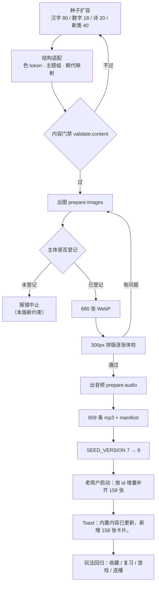

# PRD · 童识认知卡片 v0.5（内容大扩容）

| 项 | 内容 |
| --- | --- |
| 文档版本 | v0.5.0 |
| 状态 | **已确认**（四项范围与规模经需求方确认，已进入技术方案阶段；方案确认后开工） |
| 主题 | 内容大扩容：汉字加量 + 数字 1–100 精选 + 四个新主题分类 + 古诗加量 |
| 关联文档 | `FR/v0.1/内容体系与首批卡片清单.md`（内容口径底座）、`FR/v0.1/PRD.md`、`FR/v0.2/PRD-故事绘本.md`、`FR/v0.4/PRD.md`（玩法与发音契约）、`NFR/v0.5/技术方案.md`（已成稿，开工前待确认） |
| 交付形态 | 纯前端 Web（React + TypeScript），无后端、无账号、数据存浏览器本地 |
| 版本类型 | **内容版本**：只扩种子数据与配套素材，`Card` / `Category` 字段、路由、导入导出契约零变更 |
| 更新日期 | 2026-10-30 |

## 变更记录

| 日期 | 版本 | 变更内容 |
| --- | --- | --- |
| 2026-10-30 | v0.5.0 | 首次成稿：需求方提出「再增加汉字、数字，还有其他的，都丰富一下」，明确四项范围（汉字加量 / 数字扩充 / 新增主题分类 / 古诗加量）与数字深度（1–100 精选）。本版把 v0.5 定义为**内容扩容版**，原路线图 v0.5 的「汉字笔顺动画、多龄段模式、拼音自动标注、PWA 离线安装」整体顺延至 v0.6（理由见 §1.3，属版本主题占用，与 v0.3 占用「学习闭环」同例） |
| 2026-10-30 | v0.5.0（确认） | 需求方确认本版范围：① 汉字按 **+80 字**（五个新学习组、主题组 7 → 8）；② 新分类**沿用 §4.4 四类**（海洋动物 / 小虫子 / 职业 / 穿戴，各 10 张）；③ 数字按 **28 张**骨架（十一–二十 / 三十–九十 / 一百）；④ 古诗 **+20 首**。同步更正：穿戴分类的色 token 由草记的 `apricot2` 定为 `linen`（与技术方案 §4.4 一致，token 名不得带数字） |

---

## 1. 需求背景与目标

### 1.1 背景

v0.4 把「听得准、记得住、能练能玩」补齐之后，产品真正的短板回到了**内容本身**：

| 现状 | 问题 |
| --- | --- |
| 汉字 241 字 | 覆盖的是基础常用字，但「的、了、在、是」这类出现频率最高的虚词一个都没有；孩子开始指读时，绕不开这批字 |
| 数字 10 张（一–十） | 分类叫「数字」却只到十。两岁孩子数到二十、三十的诉求很自然，「十一」这种中文构词难点更是完全没有承载 |
| 实物分类 14 类 | 海洋里的动物、身边的小虫子、每天要穿的衣鞋、要认的大人职业——这四块是 1–3 岁认知清单里的高频主题，现在只能散落在「动物」「日常用品」里，不成体系 |
| 古诗 30 首 | 启蒙量级偏薄，缺《游子吟》《草》《小池》《村居》《敕勒歌》这类最短也最常背的名篇 |

### 1.2 目标

| 目标 | 衡量方式 |
| --- | --- |
| G1 内容规模显著扩 | 内置卡片 501 → **659 张**，分类 17 → **21 个**；不引入任何字段与路由变更 |
| G2 汉字补齐高频字 | 汉字 241 → **321 字**（+80），新字全部是「读绘本一定躲不开」或「身边指得出」的字 |
| G3 数字数得下去 | 数字 10 → **28 张**（十一–二十、三十–九十、一百），卡片画面数字与中文数字必须对应正确 |
| G4 四个新主题成类 | 海洋动物 / 小虫子 / 职业 / 穿戴，各 10 张，每类都够听音选图出题（分类内 ≥ 5 张） |
| G5 古诗翻倍且分得开 | 古诗 30 → **50 首**，按朝代分「唐诗 / 宋词 / 汉魏与明清」三组可筛选 |
| G6 老用户不丢东西 | 升级后自动补齐新内容，家长自建与改过的卡片保持原样，收藏 / 标记 / 最近浏览不受影响 |
| G7 画风不破 | 新增每一张图与既有 518 张同族，且沿用 v0.3 的三条硬约束（缩略图可辨识、同模板须有轮廓差异、同框比例一致） |

### 1.3 与既有路线图的关系（版本主题占用）

`FR/README.md` §6 原写 v0.5 =「内容与体验：汉字笔顺动画、多龄段模式、拼音自动标注、PWA 离线安装」。本版做**主题占用**：

| 项 | 处理 |
| --- | --- |
| v0.5 | 改为「内容大扩容」（本版，纯内容与素材） |
| 笔顺动画 / 多龄段模式 / 拼音自动标注 / PWA | 整体顺延到 **v0.6**；原 v0.6「生产工具」→ v0.7，原 v1.0「云端协同」不变 |
| 为什么占用 | ① 内容扩充是需求方当下的直接诉求，且零契约风险；② 笔顺动画与 PWA 都是重管线工程，混在一版会让「内容门禁 + 视觉体检」和「新交互 + 离线缓存」两套验收互相拖累；③ 先把量堆够，v0.4 已有的复习 / 游戏 / 连播才有的玩 |

### 1.4 版本主题拆分（交付顺序）

| 里程碑 | 内容 | 依赖 | 状态 |
| --- | --- | --- | --- |
| **M-A 结构先行** | 数字出图口径改造、诗词朝代三组映射、汉字第八主题组、四个新分类与色板 token | 无 | 待做 |
| **M-B 文字内容** | 汉字 +80、数字 +18、古诗 +20 的种子行与字段（拼音 / 笔画 / 组词 / 译文） | M-A | 待做 |
| **M-C 素材生成** | 新分类 40 张实物卡种子 + 出图脚本新增主体与诗景 + 全量出图 + 新增音频 158 条 | M-B | 待做 |
| **M-D 体检与回归** | 新图逐张体检、升级合并回归、玩法回归、门禁与文档回写 | M-C | 待做 |

---

## 2. 内容规模总表

| 分类 | 现状 | v0.5 目标 | 增量 | 增量构成 |
| --- | --- | --- | --- | --- |
| 数字 numbers | 10 | **28** | +18 | 十一–二十（10）、三十–九十（7）、一百（1） |
| 汉字 characters | 241 | **321** | +80 | 五个新学习组各 16 字（见 §4.1） |
| 古诗 poems | 30 | **50** | +20 | 唐 +10、宋 +5、汉魏与明清 +5 |
| 海洋动物 sea（新） | 0 | **10** | +10 | `kind=object` |
| 小虫子 insects（新） | 0 | **10** | +10 | `kind=object` |
| 职业 jobs（新） | 0 | **10** | +10 | `kind=object` |
| 穿戴 clothes（新） | 0 | **10** | +10 | `kind=object` |
| 其余 14 个实物分类 | 150 | 150 | 0 | 本版不补（控制美术增量，见 §8） |
| 故事 stories | 50 | 50 | 0 | 本版不加 |
| **合计** | **501 张 / 17 类** | **659 张 / 21 类** | **+158** | 图片 518 → 680 张（含 21 张分类封面），音频 501 → 659 条 |

---

## 3. 用户故事与验收标准

### US-C1 汉字加量（P0）

作为家长，我希望字库把绘本里最常见的字补齐，以便孩子指读时不遇到「这应用里怎么没有」。

- Given 汉字分类页，Then 总数显示 321 张；八个主题组 chips 为「数字与量 25 / 身体与家人 55 / 自然与季节 44 / 动物与植物 38 / 方位与地点 38 / 动作与形容 44 / 生活与学习 61 / 口语与常用 16」。
- Given 每个新字卡，Then 有单字 + 带声调拼音 + 英文词（≤ 3 词）+ 笔画数（1–30）+ 两个组词，与既有 241 字同一套字段口径。
- Given 新字与既有字拼音相同（如「是 / 十」都读 shì），Then 卡片 id 用带类别后缀的 slug，不出现 id 重复。
- Given 任一汉字卡，Then 该字必须且只能归入一个主题组；`scripts/validate-content.mjs` 的双向覆盖校验必须通过（既不能有没分组的字，也不能分组表里有字卡里没有的字）。
- Given 汉字卡图片，Then 沿用既有字形画法（白卡 + 楷体字 + 底墨线），与既有 241 张完全同族。

### US-C2 数字 1–100 精选（P0）

作为家长，我希望孩子数完十以后能接着往下数，以便「二十、三十」这些词有卡可指。

- Given 数字分类页，Then 28 张卡按 一→十、十一→二十、三十→九十、一百 的顺序排列。
- Given 「十二」这张卡的图片，Then 画面阿拉伯数字是 **12**、下方中文数字是 **十二**；不得出现「按排列位置算数字」导致的 21 / 31 错位。
- Given 「一百」的图片，Then 画面是 100 + 一百，字号必须容得下三位数（不留白溢出）。
- Given 数字卡仍走实物卡形态（`kind=object`），Then 点读中文读「十二」、英文读 "twelve"，英文音频按 `en` 生成。
- Given 复习与听音选图取数字分类出题，Then 四张选项全部来自数字分类（同分类干扰优先）。

### US-C3 四个新主题分类（P0）

作为家长，我希望「海里的」「小虫子」「大人做的职业」「要穿的衣服」各自成一类，以便按主题带孩子在现实里对应上。

- Given 首页分类墙，Then 出现 21 个分类，新四个排在末尾（海洋动物、小虫子、职业、穿戴），各带自己的封面图与主题色。
- Given 每个新分类，Then 恰好 10 张卡，一屏内可完成组内浏览（不分页）。
- Given 新分类的 40 张实物卡图片，Then 主体在 300px 缩略图下可辨识；同一画师系列（如鱼 / 虫 / 人）之间必须有轮廓或身份件差异，不得「换个颜色算一张」。
- Given 新分类的卡片，Then 中文、拼音（带声调）、英文（≤ 3 词）、难度（1–3）齐备，且都有对应的自带英文音频。
- Given 家长管理区，Then 新分类与普通分类一样可改名、可删、可自建卡片，走既有 CRUD 不加特例。

### US-C4 古诗加量（P1）

作为家长，我希望把最常被问到的名篇收进来，以便孩子听到「春眠不觉晓」时能找到下一首。

- Given 古诗分类页，Then 总数 50 首；组 chips 为「唐诗 30 / 宋词 15 / 汉魏与明清 5」。
- Given 《所见》《敕勒歌》这类非唐宋的诗，Then 归入「汉魏与明清」组，不得被错分进「宋词」（现状是「不是唐就归宋」，本版必须改）。
- Given 每首新诗，Then 标题（≤ 20 字）+ 带声调拼音 + 英文名 + 作者 + 朝代 + 按句分行正文（2–8 行，每行 ≤ 14 字）+ 白话译文（≤ 90 字）齐备。
- Given 每首新诗的封面，Then 按既有水墨画师指派一个场景，同一场景最多 4 首（避免整组雷同）；需要新增的场景不超过 3 个。
- Given 详情页，Then 新诗与既有 30 首同一套渲染（标题 / 朝代·作者 / 正文 / 译文 /「读全诗」），无需新交互。

### US-C5 老用户升级不丢东西（P0）

作为已经在用的家长，我希望更新之后新内容自己出现，以便不用清数据重来。

- Given 本地已有一版种子数据且做过家长改动，When 应用到新 `SEED_VERSION`，Then 按 id **增量补齐** 158 张新卡与 4 个新分类，已有卡片与已被改过的内置卡一律不覆盖。
- Given 补齐完成，Then Toast 说明「内置内容已更新，新增 158 张卡片。」（沿用现有文案口径，数字随实际增量）。
- Given 收藏 / 认识标记 / 最近浏览，Then 全部保持原样（新卡 id 不在旧记录里，不存在孤立引用）。
- Given 家长自建卡恰好与某个新内置卡同 id，Then 保留家长的版本、不写重复 id，并在管理区计数中体现真实总数。
- Given 只读模式（存储不可用），Then 直接加载新种子，可浏览全部 659 张，管理功能仍禁用。

### US-C6 新内容立刻能在既有玩法里用（P1）

作为家长，我希望新加的卡马上能收、能练、能播，以便内容不是死库存。

- Given 任意新卡详情页，Then 收藏 / 认识·不认识 / 连播 / 朗读全部可用，零代码适配（走既有分类内翻页与分组翻页）。
- Given 连播在新增的「小虫子」分类内开启，Then 读完 10 张后停止并提示「这一组看完啦」，行为与既有分类一致。
- Given 听音选图，Then 新分类可作为出题范围（每类 10 张 ≥ 4 选项 + 3 干扰）。
- Given 首页统计与复习队列，Then 新卡标记计入「已标记 N 张 · 其中 M 张还不熟」，标记为不认识的自动进复习队列。

---

## 4. 内容清单（本版唯一新增内容，逐条可核对）

### 4.1 汉字新增 80 字（五个新学习组）

| 学习组 | 16 字 | 归入主题组 |
| --- | --- | --- |
| 二十一、常用虚词与口语 | 的 了 在 是 有 不 也 都 就 要 会 能 很 这 那 和 | 口语与常用（新组，16） |
| 二十二、自然与气象补 | 冰 霜 露 雾 霞 虹 泉 瀑 峰 原 野 尘 气 阳 阴 空 | 自然与季节（28 → 44） |
| 二十三、虫鱼鸟兽补 | 燕 鹊 鹰 鸽 雁 鹭 虾 蟹 龟 蛇 猴 熊 狼 狐 蛛 蚁 | 动物与植物（22 → 38） |
| 二十四、身体与动作补 | 脸 眉 唇 掌 拳 臂 膝 颈 腰 毛 皮 骨 拍 踢 举 擦 | 身体与家人（37 → 55）／动作与形容（40 → 44） |
| 二十五、亲人与社会补 | 伯 叔 姑 舅 姨 孙 邻 伴 医 师 警 兵 村 店 厂 校 | 身体与家人／生活与学习（55 → 61）／方位与地点（34 → 38） |

- 选取标准：① 绘本高频出现；② 能在生活里指认；③ 与既有 241 字零重复（清单已按此核对）。
- 逐字口径：笔画数按规范笔顺计数；组词两个，优先「叠字称呼 + 常见双音词」（例：燕 → 燕子 / 小燕）。
- 「二十四、二十五」两组是跨主题拆分：身体名词与动作词分别落「身体与家人」「动作与形容」，亲属与社会称谓落「身体与家人」「生活与学习」「方位与地点」，具体归属在技术方案里成表，最终由分组覆盖校验兜住。

### 4.2 数字新增 18 张

| 段 | 卡片 | 张数 |
| --- | --- | --- |
| 十几 | 十一、十二、十三、十四、十五、十六、十七、十八、十九、二十 | 10 |
| 整十 | 三十、四十、五十、六十、七十、八十、九十 | 7 |
| 整百 | 一百 | 1 |

- 不做 21–99 的逐个数字（79 张同类图毫无信息增量，且音频与图片各多 79 份），只给「数得过去的骨架」。
- 英文一律用序数以外的基数词单词（eleven … one hundred），保证 ≤ 3 词、能出短音频。

### 4.3 古诗新增 20 首

| 组 | 篇目（· 作者 · 场景） |
| --- | --- |
| 唐诗 +10 | 赠汪伦·李白·river；游子吟·孟郊·cottage；草（赋得古原草送别）·白居易·grassland（新）；春夜喜雨·杜甫·night；小儿垂钓·胡令能·lake；竹里馆·王维·bamboo（新）；悯农·其二·李绅·farm；夜宿山寺·李白·tower；绝句·迟日江山丽·杜甫·blossom；宿建德江·孟浩然·river |
| 宋词 +5 | 小池·杨万里·lotus；晓出净慈寺送林子方·杨万里·lotus；题西林壁·苏轼·mountain；饮湖上初晴后雨·苏轼·lake；示儿·陆游·cottage |
| 汉魏与明清 +5 | 长歌行·汉乐府·river；敕勒歌·南北朝·grassland（新）；所见·清·袁枚·cattle（新）；村居·清·高鼎·spring；石灰吟·明·于谦·mountain |

- 难度分布延续现状：五言短诗与《静夜思》同级标 1，七言与长句标 2，词与典故多的标 3。
- 新增场景只有 3 个（grassland / bamboo / cattle），其余全部复用既有水墨场景，保证画风零漂移。

### 4.4 四个新分类各 10 张

| 分类（id · 色 token） | 10 张卡（中文 · 拼音 · 英文） |
| --- | --- |
| 海洋动物 `sea` · `wave` | 鲸鱼 jīng yù whale；海豚 hǎi tún dolphin；鲨鱼 shā yú shark；企鹅 qǐ é penguin；海豹 hǎi bào seal；螃蟹 páng xiè crab；章鱼 zhāng yú octopus；水母 shuǐ mǔ jellyfish；海马 hǎi mǎ seahorse；贝壳 bèi ké shell |
| 小虫子 `insects` · `moss` | 瓢虫 piáo chóng ladybug；蜗牛 wō niú snail；蜘蛛 zhī zhū spider；毛毛虫 máo máo chóng caterpillar；蚱蜢 zhà měng grasshopper；蚊子 wén zi mosquito；蚂蚁 mǎ yǐ ant；蚯蚓 qiū yǐn earthworm；蜻蜓 qīng tíng dragonfly；蝉 chán cicada |
| 职业 `jobs` · `denim` | 医生 yī shēng doctor；护士 hù shi nurse；厨师 chú shī cook；消防员 xiāo fáng yuán firefighter；警察 jǐng chá police officer；农民 nóng mín farmer；司机 sī jī driver；邮递员 yóu dì yuán mail carrier；军人 jūn rén soldier；画家 huà jiā painter |
| 穿戴 `clothes` · `linen` | 衬衫 chèn shān shirt；裤子 kù zi pants；裙子 qún zi skirt；连衣裙 lián yī qún dress；外套 wài tào coat；袜子 wà zi socks；手套 shǒu tào gloves；围巾 wéi jīn scarf；背心 bèi xīn vest；靴子 xuē zi boots |

- 分类 `sortOrder` 追加为 18–21，不插队，避免打乱家长已有的排序。
- 色 token 是纯增量枚举（`COLOR_TOKENS` 17 → 21），新增四个变量落 `styles/tokens.css`；具体色名与色值在技术方案定稿，本版只锁「不得复用既有 token、不得改既有 17 个的色值」。
- 与既有卡不重复：帽子 / 鞋子仍在「日常用品」，蜜蜂 / 蝴蝶 / 乌龟仍在「动物」，老师仍在「家人」——新类只收本类主题内的新主体。

---

## 5. 内容规范与管线口径

| 项 | 口径 |
| --- | --- |
| 校验门禁 | 全部新内容必须过 `npm run validate:content`：拼音含声调、英文 ≤ 3 词、汉字中文必须 1 字、笔画数 1–30、诗标题 ≤ 20 字 / 正文 2–8 行 / 每行 ≤ 14 字 / 译文 ≤ 90 字、卡片与分类 id 唯一、汉字分组双向覆盖 |
| 图片 | `npm run prepare:images` 程序化生成，输出 680 张（659 卡片图 + 21 分类封面），沿用 320×320 / 封面 480×360 / WebP 质量 82；汉字卡与诗封面画法不变，新实物卡主体需逐个登记 |
| 数字出图 | 现状按「排列位置 + 1」推算阿拉伯数字，加到 28 张必然错位；本版改为**按卡片中文数字解析**，中文数字表也同步扩到能覆盖「一百」 |
| 音频 | `npm run prepare:audio` 为 659 张卡各生成一条 mp3（单声道 22.05kHz 32kbps，单条 ≤ 12KB），清单 `manifest.json` 同步；新增条目 158 条，全量目标 ≤ 5MB |
| 内置版本号 | `SEED_VERSION` 7 → 8；触发增量合并与升级 Toast |
| 应用版本号 | `package.json` 与 `src/app/version.ts` 两处同步 0.4.0 → 0.5.0 |
| 种子写法约束 | 新实物卡数组必须写成 `const 名称: readonly Row[] = [...]` 并在 `SEED_CARDS` 里 `buildObjects('categoryId', 名称)`，两个脚本靠这两处形态解析；新分类需在 `categories.ts` 增加一行并给封面路径 |

---

## 6. 交互与视觉约束（沿用既有硬约束）

| 约束 | 本版落点 |
| --- | --- |
| 缩略图可辨识（v0.3.0） | 新增 40 张实物卡与 4 张封面在 300px 下必须看得出是什么，小于 3px 的描线一律不许 |
| 同模板须有轮廓差异（v0.3.1） | 十条虫子不能只是换色：腿数 / 触角 / 翅膀 / 壳 至少一项形态不同；十条职业靠身份件（帽 / 器具 / 服色）区分 |
| 同框比例（v0.3.2） | 职业人物与故事人物共用同一档位，头身比与四肢不得脱离躯干 |
| 画风同族（v0.3） | 新图沿用「渐变天 + 地面带 + 彩色扁平主体」；诗封面沿用「宣纸底 + 墨色三层景」，emoji 与单色剪影不得回退 |
| 首页密度 | 分类墙由 17 张变 21 张，仍为首页主体；顶部三入口条、接着看横滑、底部统计与说明链接的次序与占比不变 |
| 分组 chips | 汉字八组、古诗三组，chips 允许换行但不得横向溢出，选中态与既有一致 |
| 触控与可访问性 | 本版无新增按钮形态；新分类与新卡自动继承既有 `aria-label` 与 ≥ 48px 触控要求 |
| 隐私 | 依旧全本地、零上报、零埋点 |

---

## 7. 边界条件与异常场景

| 场景 | 处理 |
| --- | --- |
| 新旧卡拼音 slug 撞车（是 / 十 同 shì，她 / 蛇 同 tā… ） | 新卡加类别后缀（沿用既有 `jiu-old` 的做法），id 唯一性由门禁兜 |
| 家长改过某张内置卡，本版又动了同 id 卡的内容 | 只补新 id，不覆盖：家长改动优先，文档明确「内置内容更新只增不改」 |
| 家长自建卡 id 与新内置卡相同 | 保留自建卡，新内置卡不再写入（按 id 去重），管理区计数为真实总数 |
| 本地存储写不下（配额满） | 沿用既有降级：进入只读并给原因，不因内容变大而崩溃 |
| 设备是隐私模式 / 只读 | 直接加载新种子浏览，管理入口禁用语义不变 |
| 图片脚本认不出新主体 | 现状会画成「只有背景没有主体」的静默结果，本版必须改为**明确报错中止**，不允许产出没有主体的卡 |
| 新分类图片尚未生成 | 内容门禁按文件存在性报错并提示运行 `npm run prepare:images`，与现状一致 |
| 音频缺一条或超 12KB | 门禁报错（与 v0.4 M-A 一致），不得带着缺口发版 |
| 听音选图遇到只有 10 张的新分类 | 足够出题；跨类补齐逻辑不变 |
| 复习队列取到新增汉字 | 无特例，按难度升序每轮 ≤ 10 张 |
| 静态资源体积上涨 | 680 图 + 659 音频（约 6MB），部署体积上限不设硬线，但 JS gzip 有预算（见 §9） |

---

## 8. 本版明确不做

| 不做 | 原因 |
| --- | --- |
| 汉字笔顺动画、多龄段模式、拼音自动标注、PWA 离线安装 | 原 v0.5 规划，整体顺延 v0.6，不与本版混装 |
| 数字 21–99 逐个成卡 | 79 张同类图零信息增量，素材成本与视觉噪声都不划算 |
| 既有 14 个实物分类补卡 | 本版美术增量已全部给四个新类，旧类补卡留下一版 |
| 故事加本（仍 50 本） | 故事涉及寓意 / 分段 / 综合图三处口径，改造量与本版「只加数据」定位不符 |
| 真人录音替换、逐条听感复评 | 保留 v0.4 的「同名替换」能力，替换动作不在本版执行 |
| 新增字段 / 新 `kind` / 路由变更 / 导入导出结构变更 | 内容版本必须零契约风险 |
| 搜索、按难度筛选、繁简切换、整句英文朗读 | 与本版目标无关 |
| 给家长自建卡生成音频 | 自建卡 `en` 不可控，维持 TTS 回退 |

---

## 9. 非功能性需求

| 维度 | 要求 |
| --- | --- |
| 包体 | 种子文本进主包：JS gzip 174.02KB → **≤ 200KB**（本版预算 +26KB，硬线 350KB 不变）；CSS gzip 仍 ≤ 8KB |
| 静态资源 | 图片 680 张 ≤ 1.9MB、音频 659 条 ≤ 5MB；单图仍 ≤ 8KB、单条音频 ≤ 12KB |
| 性能 | 分类页每页 12 张不变，卡片总量 +31.5% 不得让首屏与分类页出现可感知卡顿（列表在 store 侧一次算好，仍走既有 `useMemo`） |
| 生成耗时 | `prepare:images` 与 `prepare:audio` 全量重跑必须可在一次开发会话内完成，增量的 `--only` / 跳过已存在策略保持可用 |
| 兼容 | 旧数据（v0.1–v0.4 任一模板）读取与迁移不受影响；`schemaVersion` 不变 |
| 可访问性 | 新分类名与新卡中文供屏幕阅读器朗读，`aria-label` 沿用「{zh} 卡片详情」口径 |
| 可核对性 | 内容门禁输出的分类与分组统计表必须能一眼核对本版增量（合计行 659 张 / 21 个分类） |

---

## 10. 验收标准（DoD）

- [ ] 内置内容 **659 张 / 21 个分类**，`npm run validate:content` 通过（含拼音声调、英文词数、汉字单字、诗词行数字数、分组双向覆盖、音频齐全与体积）
- [ ] 汉字 321 字与八主题组数量与 §2 表一致；数字 28 张；古诗 50 首且三组分布为 30 / 15 / 5；四个新分类各 10 张
- [ ] 数字卡画面数字与中文数字一一对应（含「二十」「三十」「一百」三个抽检点，测试锁定）
- [ ] 非唐宋诗不再被归进「宋词」（朝代 → 组 key 有映射表与测试）
- [ ] `npm run prepare:images` 全量出图 680 张无缺失、无「只有背景没有主体」的卡；出图脚本对未知主体改为报错中止
- [ ] 新增 158 条音频生成完毕，单条 ≤ 12KB，`manifest.json` 与卡片一一对应，清单无多余条目
- [ ] 新图按 300px 缩略图拼版逐张体检（40 张实物卡 + 4 张封面 + 20 张诗封面），问题清单逐条修完
- [ ] `SEED_VERSION` 升到 8：老数据实测「补齐 158 张 + 不覆盖家长改动 + 进度不丢」三项都有测试
- [ ] 新分类在首页 / 分类页 / 详情页 / 收藏 / 复习 / 听音选图 / 连播 七处走通，无需新增交互代码
- [ ] 色 token 与 `tokens.css` 四个新色落地，既有 17 个 token 的色值零改动
- [ ] 管理区计数断言与说明页文案同步到 659 张 / 21 个分类
- [ ] 五道门禁全绿（typecheck / lint / test / build / validate:content），用例只增不减
- [ ] `FR/README.md`（路线图、索引、变更记录）、`NFR/README.md`、`AGENT.md`、`FR/v0.5/PRD.md`、`NFR/v0.5/技术方案.md` 五处同步，中文写完后跑码点扫描（无 U+FFFD、无 U+30FB、无行尾空格、关键短语命中数核对）
- [ ] 临时产物只落 `.tmp` 且收尾清空

---

## 11. 风险与决策（草案，正式 ADR 落技术方案）

| 编号 | 议题 | 决策 | 代价与取舍 |
| --- | --- | --- | --- |
| D-C1 | v0.5 主题从「内容与体验」改为「内容大扩容」 | 占用本版，原四项顺延 v0.6 | 路线图与本次实际交付错位一版，需在 README 明示 |
| D-C2 | 数字做到 100 还是做精选 | 只做 1–20 + 整十 + 一百（28 张） | 少 71 张图与音频，代价是「100 以内不全」；幼儿数数诉求靠整十骨架满足 |
| D-C3 | 汉字一次加多少 | +80（八主题组扩到 321） | 80 字的拼音 / 笔画 / 组词需要逐条核对，笔画错是硬伤，安排人工复核 |
| D-C4 | 新分类的选法 | 海洋动物 / 小虫子 / 职业 / 穿戴，各 10 张 | 这四类主体多为「可复用既有画师」，美术增量集中在虫形与衣物形；不选乐器 / 运动 / 节日，因主体全新且形状复杂，留给下一版 |
| D-C5 | 数字卡出图口径 | 由「排列位置」改为「按中文数字解析」 | 一次性改脚本 + 补测试，换取数字可继续往后扩 |
| D-C6 | 诗词分组按朝代 | 唐 / 宋（含五代）/ 汉魏与明清三组 | 现状「非唐即宋」的逻辑必须改，`groupOf` 里那张二元判断要换成映射表 |
| D-C7 | 汉字第八主题组「口语与常用」 | 单开一组，不与「动作与形容」「生活与学习」混装 | 虚词无可指认实物，混进名词组会让家长翻找；组数 7 → 8 需同步分组表与校验 |
| D-C8 | 新分类顺序 | 追加 `sortOrder` 18–21，不插队 | 首页「海洋动物」不会紧贴「动物」，主题相邻性靠命名与配色补足；换来零排序覆盖风险 |

---

## 12. 业务流程图

