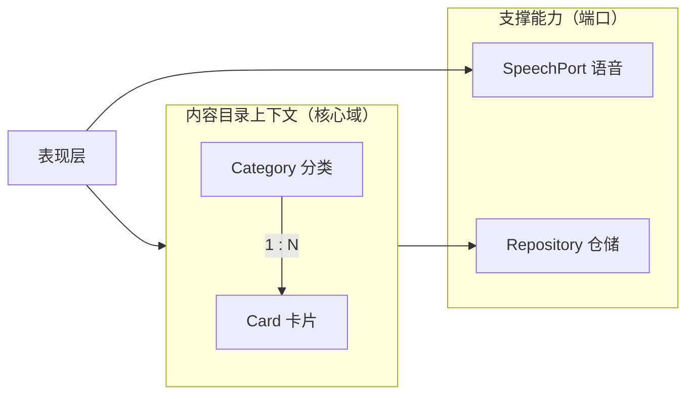
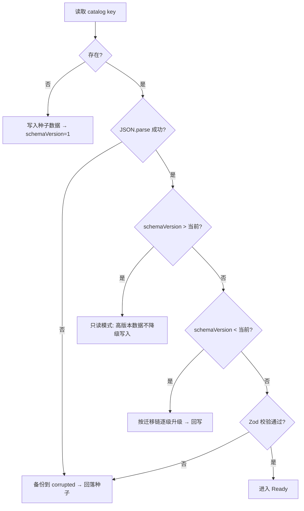

# 技术方案 · 童识认知卡片 v0.1

| 项 | 内容 |
| --- | --- |
| 文档版本 | v0.1.4 |
| 状态 | v0.1 已实现（T1–T17），四道门禁全绿；v0.1.5 已支持 `kind=poem` 诗词卡；v0.1.6 内容扩至 451 张（汉字 241 字）；v0.1.7 分类页支持主题组筛选与每页 12 张分页 |
| 对应需求 | `FR/v0.1/PRD.md`、`FR/v0.1/内容体系与首批卡片清单.md` |
| 技术总览 | `NFR/README.md` |
| 更新日期 | 2026-10-29 |

## 变更记录

| 日期 | 版本 | 变更内容 |
| --- | --- | --- |
| 2026-10-28 | v0.1.0 | 首次成稿：ADR 10 项、L2 领域模型、数据模型与迁移、仓储/存储/TTS/图片管线、任务拆解与验证方式 |
| 2026-10-28 | v0.1.1 | 实现回写：路由改用 `HashRouter`（§6）、图片管线改为脚本生成插画（§10）、补实测性能（§12）与任务完成状态（§15） |
| 2026-10-28 | v0.1.2 | 诗词卡回写：ADR-004 扩 `kind=poem`；§3.2 新增 4 个诗词字段与不变量；`ColorToken` 16 色（新增 `xuan`）；§10 新增水墨场景生成；§12 实测更新 453.03KB/147.24KB gzip；§15/§17.4 计数同步 391 张 / 16 分类 |
| 2026-10-29 | v0.1.3 | 汉字扩容回写：内容门禁与实测计数同步 451 张（汉字 241）/ 467 个 WebP；§12 实测更新 456.30KB/148.60KB gzip；§4.4/§15/§17.4 计数同步 |
| 2026-10-29 | v0.1.4 | 浏览体验回写：新增 `data/seed/characterGroups.ts`（汉字二十组归并为七组，古诗分唐/宋）；分组**不进卡片数据**（零迁移、`schemaVersion` 与 `SEED_VERSION` 均不变）；`buildCardSequence` 增加可选 `filter` 参数；分类页组筛选 + 分页状态进 URL（`?group=&page=`）；内容门禁新增分组覆盖校验；§12 实测更新 461.10KB/150.56KB gzip、CSS 24.17/6.02KB；§15/§17.4 同步 |

---

## 1. 背景、目标与复杂度判定

### 1.1 技术目标

| 目标 | 技术要求 |
| --- | --- |
| 零门槛可用 | 纯静态产物，打开即用；首屏 JS ≤ 350KB gzip |
| 未来可接后端 | 数据访问全部经仓储接口，替换实现不改 UI |
| 本地数据不自毁 | 版本化存储 + 迁移链 + 损坏备份恢复 |
| 幼儿可独立操作 | 触控尺寸、单屏单卡、无破坏性操作暴露 |
| 可持续供给内容 | 内容与代码分离（JSON seed + 导入导出），非开发者也能扩内容 |

### 1.2 复杂度判定

| 维度 | 评估 |
| --- | --- |
| 功能点数 | 12 个模块（M1–M12），其中 P0 11 个 |
| 业务规则 | 中：字段校验、分类级联、导入合并策略、存储降级 |
| 外部依赖 | 少：仅浏览器 API（Speech、Storage），无第三方服务 |
| 团队规模 | 1 人 + AI |
| **结论** | **L2（中等）→ 标准级 DDD 战术设计**：实体 + 值对象 + 不变量 + 领域服务 + 仓储接口，不做限界上下文拆分（单上下文 `Catalog`） |

领域只划一个限界上下文：**内容目录上下文 Catalog**（分类、卡片、内容一致性）。语音与存储作为**支撑能力**，以端口（Port）形式被应用层调用，不纳入领域模型。

---

## 2. 架构决策记录（ADR）

### ADR-001 纯前端 + localStorage，无后端

- **决策**：v0.1 不写任何服务端代码，数据存 `localStorage`。
- **理由**：目标用户是单个家庭、单设备使用；无账号需求；避免隐私合规与运维成本；静态托管可零成本长期在线。
- **代价**：数据不跨设备、清缓存即丢、容量约 5MB。
- **缓解**：导入/导出 JSON 作为备份与迁移手段；存储容量预警；预留 IndexedDB 与后端升级路径。
- **放弃的方案**：Supabase/Firebase 直连（引入账号与网络依赖，违背「打开即用」）；本地 Express 服务（需用户自己跑进程）。

### ADR-002 Vite + React 19 + TypeScript strict

- **决策**：Vite 7 构建，React 19，`strict` + `noUncheckedIndexedAccess`。
- **理由**：内容字段多、导入数据不可信，类型是唯一低成本契约；Vite 产物为纯静态目录，任何静态托管可用。
- **放弃的方案**：Next.js（无 SSR/SEO 需求）；CRA（已废弃）。

### ADR-003 Repository 接口隔离存储（**核心决策**）

- **决策**：UI 与 hooks 只依赖 `CategoryRepository` / `CardRepository` 接口，`localStorage` 实现位于 `data/` 层。
- **理由**：v1.0 接后端时，只需新增 `HttpCategoryRepository` 并在装配处替换，UI、领域、测试全部不变。
- **约束**：**接口方法一律 `async`**（即便本地是同步的），否则未来换 HTTP 会引发全量改造。

### ADR-004 `Card` 单实体 + `kind` 区分实物卡、汉字卡与诗词卡

- **决策**：三类卡共用 `Card` 类型，`kind: 'object' | 'character' | 'poem'`，各类专属字段均可选。
- **理由**：浏览、翻页、朗读、收藏（v0.2）、存储、导入导出 100% 复用，只有详情的展示分支不同。
- **代价**：类型上存在「汉字卡不应有 `phonetic`」这类弱约束 → 用 Zod schema + 跨字段规则函数表达条件校验。
- **v0.1.5 诗词扩展**：`poem` 只加了 `author` / `dynasty` / `lines[]` / `translation` 4 个**可选**字段，`schemaVersion` 不动（老数据仍合法，无需迁移），升级只靠 `SEED_VERSION` 补卡。
- **放弃的方案**：两张独立表/两个实体（浏览逻辑与 UI 双写，成本远高于收益）；为诗词新建独立实体与独立页面（复制一套翻页/朗读/存储成本）。

### ADR-005 真实照片 + 首字占位兜底

- **决策**：内容以真实照片为主；任何图片加载失败一律降级为「分类主色底 + 中文首字」占位块。
- **理由**：1–3 岁认物需真实形态（插画易与实物脱节）；占位保证永不白屏。
- **代价**：素材获取与授权成本高（见内容文档第 4 章）；体积大 → 双档 WebP。
- **例外**：颜色/形状/数字/汉字用生成图形（无摄影必要）；诗词用**水墨意境图**（不宜用写实照片，避免锁死画面想象）。
- **v0.1 落地**：内置 451 张先用 `scripts/prepare-images.mjs` 生成统一风格的扁平插画 / 水墨小景（见 §10），保持同一逻辑路径，后续替换实拍/AI 图无需改代码。

### ADR-006 只用浏览器 Web Speech，不接远程 TTS

- **决策**：语音走 `window.speechSynthesis`。
- **理由**：零密钥、零成本、零网络依赖、文本不出设备（隐私友好）。
- **代价**：音色与语言可用性取决于系统；部分浏览器无中文 voice。
- **缓解**：`SpeechPort` 探测能力 → 不可用则禁用按钮并提示；预留「预录音频」扩展位（v0.2 可选，字段 `audio?`）。
- **放弃的方案**：Azure/讯飞/阿里云 TTS（需密钥与网络、按量计费、文本外传）。

### ADR-007 Zustand 只管 UI 与设置，业务数据不进 store

- **决策**：Zustand 承载「设置、当前浏览上下文、Toast、家长门状态」；分类/卡片数据由仓储读取后由轻量 hook 持有。
- **理由**：业务数据若同时存在 store 与 localStorage，极易双写不一致；仓储是唯一事实来源。
- **放弃的方案**：Zustand `persist` 存业务数据（等于第二套存储，迁移逻辑双份）。

### ADR-008 语音能力抽为 `SpeechPort` 适配器

- **决策**：定义 `SpeechPort` 接口 + `WebSpeechAdapter` 实现 + `NullSpeechAdapter` 降级实现。
- **理由**：jsdom 无 `speechSynthesis`，抽接口后测试可注入 fake；未来接预录音频也是新增一个实现。

### ADR-009 `schemaVersion` + 迁移链 + 损坏备份

- **决策**：存储根对象含 `schemaVersion`；读取时逐级迁移；解析/校验失败时把原字符串备份到 `early-learn:v1:corrupted`，回落种子数据。
- **理由**：本地数据没有服务端兜底，一次 schema 变更就可能让用户数据变成不可读字符串；必须可自愈且可人工取证。

### ADR-010 图片走 `public/` + 逻辑路径拼接

- **决策**：`image` 字段存站内逻辑路径字符串（如 `/assets/images/animals/cat.webp`），资源放 `public/`。
- **理由**：家长导入 JSON 时可引用新图路径而无需重新构建；同时避免 Vite 对动态 import 的静态分析限制。
- **代价**：无构建期资源校验 → 用「占位兜底 + 内容校验脚本」补足。

---

## 3. 领域模型（L2 · 单上下文 Catalog）

### 3.1 战略视图



### 3.2 实体与值对象

**实体：Category（分类 · 聚合根之一）**

| 属性 | 类型 | 说明 |
| --- | --- | --- |
| `id` | `CategoryId` | 英文小写短横线，全局唯一，不可变 |
| `name` / `nameEn` | `string` / `string?` | 中英文名 |
| `color` | `ColorToken` | 预设 16 色之一 |
| `cover` | `string?` | 封面图逻辑路径 |
| `sortOrder` | `number` | 升序 |
| `description` | `string?` | 家长备注 |
| `createdAt` / `updatedAt` | `IsoDateTime` | 系统写入 |

**不变量**
1. `name` 1–12 字，全局唯一（大小写/首尾空格归一后比较）。
2. `sortOrder` 必须为有限整数；同值时按 `createdAt` 升序。
3. `id` 一旦创建不可修改。

**实体：Card（卡片 · 聚合根之二）**

| 属性 | 类型 | 说明 |
| --- | --- | --- |
| `id` | `CardId` | `{categoryId}-{slug}` 或 UUID |
| `kind` | `'object' \| 'character' \| 'poem'` | 卡片类型 |
| `categoryId` | `CategoryId` | 外键（弱引用，一致性由领域服务保证） |
| `zh` | `string` | 中文名 |
| `pinyin` | `string` | 带声调拼音 |
| `en` | `string` | 英文 |
| `phonetic` | `string?` | IPA |
| `image` | `string` | 图片逻辑路径或 dataURL |
| `tags` | `string[]` | ≤ 5 |
| `difficulty` | `1 \| 2 \| 3` | 难度 |
| `strokes` / `words` / `radical` | `number?` / `string[]?` / `string?` | 仅 `character` |
| `author` / `dynasty` | `string?` / `string?` | 仅 `poem`：作者（≤ 12 字）、朝代（≤ 6 字） |
| `lines` | `string[]?` | 仅 `poem`：正文按句分行，2–8 行、每行 1–14 字 |
| `translation` | `string?` | 仅 `poem`：白话译文，≤ 90 字 |
| `source` | `ImageSource?` | 图片授权溯源 |
| `createdAt` / `updatedAt` | `IsoDateTime` | 系统写入 |

**不变量**
1. `kind=object` → `zh` 长度 1–8；`kind=character` → `zh` 长度必须为 1；`kind=poem` → `zh`（标题）长度 1–20。
2. `kind=character` → `strokes` 必填且 1–30；`words` ≤ 3 且每项 ≤ 4 字。
3. `kind=poem` → `author` / `dynasty` / `translation` 非空，`lines` 长度 2–8 且每行 1–14 字。
4. `image` 非空；若为 dataURL，解码后 ≤ 500KB。
5. `tags` 去重后 ≤ 5。
6. `categoryId` 必须存在于分类集合中（应用层校验，不允许悬空）。

**值对象**

| 值对象 | 字段 | 约束 |
| --- | --- | --- |
| `ColorToken` | `mint \| coral \| leaf \| sky \| sand \| peach \| lilac \| ocean \| rainbow \| ink \| rose \| cloud \| lime \| apricot \| violet \| xuan` | 闭集，映射到 CSS 变量（v0.1.3 +5、v0.1.5 新增 `xuan` 宣纸色） |
| `Difficulty` | `1 \| 2 \| 3` | 枚举 |
| `ImageSource` | `provider, author?, url?, license` | `license` 必填 |
| `DisplayMode` | `zh \| en \| both` | 枚举 |
| `SpeechLang` | `zh-CN \| en-US` | 枚举 |

### 3.3 领域服务（纯函数，无副作用）

| 服务 | 职责 | 关键函数 |
| --- | --- | --- |
| `catalogService` | 分类与卡片一致性、排序、搜索、级联影响计算 | `sortCategories`、`filterCards`、`searchCards`、`collectCascadeTargets` |
| `validationService` | 卡片/分类 Zod schema 与条件规则 | `parseCard`、`parseCategory`、`parseImportBundle` |
| `importExportService` | 导入合并/替换策略、导出序列化、摘要统计 | `buildExportBundle`、`planImport`、`applyImport` |
| `storageMigrationService` | 版本迁移链 | `migrate(raw)` |

> 原则：领域层不 `import` React、不触碰 `window`、不读时钟以外的环境（时间由参数注入），保证 100% 可纯函数测试。

### 3.4 领域事件（轻量，用于 UI 联动）

| 事件 | 触发 | 消费者 |
| --- | --- | --- |
| `catalog:changed` | 任一 CRUD 成功 | 列表页刷新、卡片计数刷新 |
| `storage:degraded` | 进入只读/配额超限 | 全局提示条 |
| `speech:unavailable` | 探测失败 | 朗读按钮禁用 + Toast |

v0.1 用**自定义事件总线（`EventTarget` 或简单发布订阅）**实现，不引入状态机库。

---

## 4. 数据模型

### 4.1 TypeScript 类型定义

```ts
// domain/entities/category.ts
export type CategoryId = string;

export const COLOR_TOKENS = [
  'mint', 'coral', 'leaf', 'sky', 'sand',
  'peach', 'lilac', 'ocean', 'rainbow', 'ink',
  'rose', 'cloud', 'lime', 'apricot', 'violet', // v0.1.3 主题分类
  'xuan', // v0.1.5 诗词（宣纸）
] as const;
export type ColorToken = (typeof COLOR_TOKENS)[number];

export interface Category {
  id: CategoryId;
  name: string;
  nameEn?: string;
  color: ColorToken;
  cover?: string;
  sortOrder: number;
  description?: string;
  createdAt: string; // ISO 8601
  updatedAt: string;
}
```

```ts
// domain/entities/card.ts
export type CardId = string;
export type CardKind = 'object' | 'character' | 'poem';
export type Difficulty = 1 | 2 | 3;

export interface ImageSource {
  provider: string;
  author?: string;
  url?: string;
  license: string;
}

export interface Card {
  id: CardId;
  kind: CardKind;
  categoryId: CategoryId;
  zh: string;
  pinyin: string;
  en: string;
  phonetic?: string;
  image: string;
  tags: string[];
  difficulty: Difficulty;
  /** 仅 kind=character */
  strokes?: number;
  words?: string[];
  radical?: string;
  /** 仅 kind=poem（v0.2 诗词） */
  author?: string;
  dynasty?: string;
  lines?: string[];
  translation?: string;
  source?: ImageSource;
  createdAt: string;
  updatedAt: string;
}
```

```ts
// domain/entities/settings.ts
export type DisplayMode = 'zh' | 'en' | 'both';

export interface Settings {
  displayMode: DisplayMode;
  speechEnabled: boolean;
  speechRate: 0.6 | 0.8 | 1.0 | 1.2;
  speakOnEnter: boolean;
  reduceMotion: boolean;
}
export const DEFAULT_SETTINGS: Settings = {
  displayMode: 'zh',
  speechEnabled: true,
  speechRate: 0.8,
  speakOnEnter: false,
  reduceMotion: false,
};
```

### 4.2 存储结构（localStorage）

| Key | 内容 | 说明 |
| --- | --- | --- |
| `early-learn:v1:catalog` | `{ schemaVersion, categories, cards, savedAt }` | 业务数据整体存一个 key，保证读写原子性 |
| `early-learn:v1:settings` | `Settings` | 设置独立，损坏不影响内容 |
| `early-learn:v1:meta` | `{ seedVersion, lastBackupAt? }` | 种子版本与迁移标记；`seedVersion` 落后时按 id 增量补齐新卡（不覆盖家长编辑） |
| `early-learn:v1:corrupted` | `string` | 校验失败时的原始字符串备份（仅保留最近一次） |

> **为什么业务数据存一个 key**：分类与卡片必须整体一致（卡片不能指向不存在的分类）。分成两个 key 时，写入中途失败会产生悬空引用；单 key 单次 `setItem` 是原子的。

```ts
export interface CatalogDocument {
  schemaVersion: number; // v0.1 = 1
  categories: Category[];
  cards: Card[];
  savedAt: string;
}
```

### 4.3 迁移与自愈策略



迁移链形式：

```ts
// data/storage/migrations.ts
type Migration = (doc: unknown) => unknown;
export const MIGRATIONS: Record<number, Migration> = {
  // 1 -> 2 时新增：MIGRATIONS[1] = (doc) => ({ ...doc, schemaVersion: 2, cards: ... })
};
```

规则：
1. **只前进不后退**：读到更高版本的 schema → 只读模式，提示「数据来自更新版本，请升级应用」。
2. 迁移函数必须幂等且不抛异常；单步失败 → 视为损坏，走备份 + 回落。
3. 每次成功迁移后立即回写，避免重复迁移。
4. 数据只会在「用户显式操作」或「迁移」时写入，不做后台写。
5. **内容升级与结构迁移分开**：结构变更走 `schemaVersion` + 迁移链；只是内置内容变多时走 `meta.seedVersion`，按卡片 `id` 差集追加入库（幂等，且不会覆盖/复活家长删除的卡片以外的东西）。同版本内不重复合并，避免删掉的种子卡“复活”。

### 4.4 种子数据

```
data/seed/
├─ categories.ts     # 16 个分类（强类型常量）
├─ cards.ts          # 451 张卡片（汉字 241、古诗 30）
├─ characterGroups.ts # v0.1.7 分类页主题组（汉字七组 / 古诗两组，不写进卡片）
└─ index.ts          # getSeedCatalog(): CatalogDocument（SEED_VERSION 在 domain/constants.ts）
```

- 种子数据**以 TS 常量维护**（而非 JSON），获得编译期字段校验；同时提供 `scripts/export-seed-json.mjs` 导出可供人工编辑的 JSON。
- 首次访问（catalog key 不存在）时写入种子并记下 `meta.seedVersion`；之后 `SEED_VERSION` 上调时**只增量补入新卡片**（按 `id` 差集），不会覆盖家长已修改或删除的卡片内容。

---

## 5. 分层架构与文件清单

### 5.1 依赖规则

| 层 | 可依赖 | 禁止 |
| --- | --- | --- |
| `features/*/ui` | hooks、shared/ui、domain 类型 | 直接 import `data/*` 实现 |
| `features/*/hooks` | domain 服务、仓储接口 | 直接访问 `localStorage` |
| `domain/*` | 仅 TS 标准库 | React、浏览器 API、`data/*` |
| `data/*` | domain 类型与接口、浏览器 API | React、`features/*` |
| `shared/*` | domain 类型 | `data/*`、`features/*` |

### 5.2 文件清单（v0.1 目标）

```
src/
├─ main.tsx
├─ app/
│  ├─ App.tsx                    # 路由出口 + 全局 Provider
│  ├─ router.tsx                 # createBrowserRouter，路由级懒加载
│  ├─ providers.tsx              # Bootstrap（数据加载/降级）· Toast · Settings
│  └─ layout/
│     ├─ AppShell.tsx            # 安全区、全局提示条
│     └─ ReadOnlyBanner.tsx
├─ domain/
│  ├─ entities/{category,card,settings}.ts
│  ├─ services/{catalog,validation,importExport}.ts
│  ├─ ports/{speech.port.ts,category.repository.ts,card.repository.ts}
│  └─ constants.ts               # 尺寸/语速/上限等魔数集中处
├─ data/
│  ├─ storage/{keys.ts,localStorageAdapter.ts,migrations.ts,quota.ts}
│  ├─ repositories/{localCategoryRepository.ts,localCardRepository.ts}
│  ├─ speech/{webSpeechAdapter.ts,nullSpeechAdapter.ts,detect.ts}
│  └─ seed/{categories.ts,cards.ts,seed-version.ts,index.ts}
├─ features/
│  ├─ categories/{ui/CategoryGrid.tsx,ui/CategoryTile.tsx,hooks/useCategories.ts}
│  ├─ cards/{ui/CardGrid.tsx,ui/CardTile.tsx,ui/CardDetail.tsx,
│  │         ui/CardFace.tsx,ui/CardToolbar.tsx,hooks/useCards.ts,hooks/useCardNav.ts}
│  ├─ admin/{ui/AdminLayout.tsx,ui/CategoryAdmin.tsx,ui/CardAdmin.tsx,
│  │         ui/CardForm.tsx,ui/DataAdmin.tsx,ui/DangerConfirm.tsx}
│  ├─ settings/{ui/SettingsPage.tsx,ui/DisplayModeSwitch.tsx}
│  └─ speech/{ui/SpeakButton.tsx,hooks/useSpeech.ts}
├─ shared/
│  ├─ ui/{Button,IconButton,ImageWithFallback,EmptyState,ParentGate,Toast,
│  │        Modal,Field,NumberStepper,ColorPicker}.tsx
│  ├─ hooks/{useMediaQuery.ts,useLongPress.ts,useSwipe.ts,useDebouncedValue.ts}
│  └─ utils/{id.ts,normalize.ts,format.ts,download.ts}
├─ styles/{tokens.css,index.css}
└─ test/{setup.ts,fixtures/catalog.fixture.ts}
```

### 5.3 关键组件契约

| 组件 | Props 要点 | 行为约束 |
| --- | --- | --- |
| `ImageWithFallback` | `src, alt, zh, colorToken, ratio` | `onError` → 占位块；始终输出 `width/height` 防抖动 |
| `ParentGate` | `onPass`, `cooldownMs` | 长按 3s → 算题；3 次错误冷却 30s |
| `CardFace` | `card, mode, speech` | 依 `mode` 渲染中/英/拼音；汉字卡走字形分支 |
| `CardToolbar` | `onSpeak(lang), onPrev, onNext, index, total` | 边界禁用按钮（不隐藏，避免布局跳动） |
| `SpeakButton` | `text, lang, rate, disabled` | 语音不可用 → `aria-disabled` + 提示 |
| `DangerConfirm` | `title, detail, requireText?` | 删除分类需展示「将同时删除 N 张卡片」 |
| `CategoryPage`（v0.1.7） | 无 props；状态取自路由参数 `?group=&page=` | 每页 12 张；卡片数 ≤ 12 不出分页，组数 ≤ 1 不出筛选条；非法 group / 越界页码回退到全部 / 第 1 页；切组重置页码并滚回顶部 |

---

## 6. 路由与页面

采用 `HashRouter`（`react-router-dom` v7 的 `<HashRouter>` + `<Routes>`）：URL 形如 `/#/card/animals-cat`，静态托管在任意子路径下都无需 SPA rewrite，与 `vite base: './'`、相对图片路径一致（R6 已落实）。

> 取舍：放弃路由级 `lazy`，单包体积实测 148.60KB gzip（预算 350KB），换来实现简单与首屏零等待；若 v0.2 体积接近预算，再按路由拆分 `React.lazy`。

```tsx
// app/router.tsx（实际实现）
<CatalogProvider>
  <HashRouter>
    <Routes>
      <Route element={<AppShell />}>
        <Route index element={<HomePage />} />
        <Route path="c/:categoryId" element={<CategoryPage />} />
        <Route path="card/:cardId" element={<CardDetailPage />} />
        <Route path="settings" element={<SettingsPage />} />
        <Route path="admin" element={<AdminGuard><AdminLayout /></AdminGuard>}>
          <Route index element={<CategoryAdmin />} />
          <Route path="cards" element={<CardAdmin />} />
          <Route path="data" element={<DataAdmin />} />
        </Route>
        <Route path="*" element={<NotFoundPage />} />
      </Route>
    </Routes>
  </HashRouter>
</CatalogProvider>
```

| 页面 | 数据输入 | 关键状态 |
| --- | --- | --- |
| 首页 | 分类列表 + 每类卡片数 | 空态、只读提示 |
| 分类页 | 分类 + 其卡片 | 空态、分类不存在、当前主题组、当前页 |
| 卡片详情 | 卡片 + 同分类序号 | 展示模式、语音可用性、边界按钮禁用 |
| 设置 | `Settings` | 即时保存 + 恢复默认 |
| 管理·卡片 | 卡片列表 + 分类字典 | 筛选、搜索、表单校验、删除确认 |
| 数据 | 存储占用估算 | 导入模式选择、摘要确认、错误定位 |

**导航上下文**：详情页的上一张/下一张基于「进入时的分类序列 + 索引」，通过 `location.state` 传递，避免详情页再猜分类；直接深链时按卡片所属分类构建序列。
v0.1.7 补充：序列可传 `filter`（按 `?group=` 只留当前主题组），`location.state.listUrl` 记录来源列表 URL，返回按钮与 Esc 均回该 URL（含分组与页码）。分组归属由 `characterGroups.ts` 查询，不依赖卡片字段，因此老数据与家长自建卡均不需要迁移。

---

## 7. 仓储与存储层

### 7.1 端口定义

```ts
// domain/ports/category.repository.ts
export interface CategoryRepository {
  list(): Promise<Category[]>;
  get(id: CategoryId): Promise<Category | undefined>;
  create(input: Omit<Category, 'id' | 'createdAt' | 'updatedAt'> & { id?: CategoryId }): Promise<Category>;
  update(id: CategoryId, patch: Partial<Omit<Category, 'id' | 'createdAt'>>): Promise<Category>;
  remove(id: CategoryId): Promise<{ removedCategories: number; removedCards: number }>;
  reorder(orderedIds: CategoryId[]): Promise<void>;
}
```

```ts
// domain/ports/card.repository.ts
export interface CardRepository {
  listAll(): Promise<Card[]>;
  listByCategory(categoryId: CategoryId): Promise<Card[]>;
  get(id: CardId): Promise<Card | undefined>;
  search(keyword: string): Promise<Card[]>;
  create(input: CardInput): Promise<Card>;
  update(id: CardId, patch: Partial<CardInput>): Promise<Card>;
  remove(id: CardId): Promise<void>;
  bulkUpsert(cards: Card[]): Promise<{ inserted: number; updated: number }>;
  replaceAll(cards: Card[]): Promise<void>;
}
```

### 7.2 实现要点（`LocalCatalogStorage` + 两个 Repository）

1. **单一文档**：两个仓储共享一个 `CatalogDocument` 读改写门面，避免分类/卡片分 key 不一致。
2. **读缓存**：进程内缓存解析后的文档 + `savedAt` 版本号；写入后失效。避免每次点击都 `JSON.parse` 全量数据。
3. **原子写**：`read → mutate → validate → setItem`，任一步失败即回滚（内存缓存不更新）。
4. **写入错误分类处理**

   | 错误 | 处理 |
   | --- | --- |
   | `QuotaExceededError` | 抛 `StorageQuotaError`，UI 提示导出备份并删除内容 |
   | SecurityError（隐私模式） | 抛 `StorageUnavailableError` → 全局切只读模式 |
   | 其他 | 抛 `StorageWriteError`，保留内存态不变 |

5. **多标签页**：监听 `window.storage` 事件 → 使缓存失效 → 触发 `catalog:changed`；若本地存在未保存的表单，UI 提示「内容已在其他标签更新」。
6. **容量估算**：`estimateUsage()` 汇总 key 字节数，超过 3MB 在数据管理页提示。

### 7.3 装配（依赖注入）

```ts
// app/providers.tsx（示意）
const storage = createLocalCatalogStorage(window.localStorage);
const ports = {
  categories: createCategoryRepository(storage),
  cards: createCardRepository(storage),
  speech: detectSpeech() ? createWebSpeechAdapter() : createNullSpeechAdapter(),
};
```

> 未来接后端：新增 `createHttpRepositories(baseUrl)`，只改这一处装配。这是 ADR-003 的落地保证。

---

## 8. 状态管理

| 存储位置 | 内容 | 理由 |
| --- | --- | --- |
| Zustand（内存） | `settings`（并持久化到 settings key）、`toast`、`parentGate`、`readOnly` 标记、`currentCategoryId` | 跨组件共享的 UI 态 |
| 仓储 + hook 局部状态 | `categories`、`cards`、当前卡片序列 | 单一事实来源，避免双写 |
| URL | `categoryId`、`cardId`、`admin` 页签、分类页的 `?group=&page=` | 可深链、可刷新恢复 |

```ts
// features/cards/hooks/useCards.ts（示意签名）
export function useCards(categoryId?: CategoryId): {
  cards: Card[];
  loading: boolean;
  error?: Error;
  refresh: () => void;
};
```

规则：
1. 组件不直接 `import` 仓储实现，通过 `useRepositories()` 获取端口（便于测试注入 fake）。
2. 任何写操作后统一 `emit('catalog:changed')`，由订阅方 `refresh()`。
3. 设置读写在 `useSettingsStore` 内完成「写内存 + 写存储」，写失败回滚内存值并 Toast。

---

## 9. 语音方案

### 9.1 端口与实现

```ts
// domain/ports/speech.port.ts
export type SpeechLang = 'zh-CN' | 'en-US';

export interface SpeechPort {
  isSupported(): boolean;
  hasVoice(lang: SpeechLang): boolean;
  speak(text: string, lang: SpeechLang, opts?: { rate?: number }): Promise<void>;
  cancel(): void;
}
```

```ts
// data/speech/detect.ts（要点）
export function detectSpeechSupport(): { supported: boolean; zh: boolean; en: boolean } {
  if (typeof window === 'undefined' || !('speechSynthesis' in window)) {
    return { supported: false, zh: false, en: false };
  }
  const voices = window.speechSynthesis.getVoices();
  const zh = voices.some((v) => v.lang.toLowerCase().startsWith('zh'));
  const en = voices.some((v) => v.lang.toLowerCase().startsWith('en'));
  return { supported: true, zh, en };
}
```

### 9.2 关键实现细节

| 问题 | 处理 |
| --- | --- |
| Voice 异步加载 | 首次 `getVoices()` 可能为空 → **装配语音端口时就预热**（`warmVoices()` 监听 `voiceschanged` + 300ms/1500ms 兜底重拉），并把结果缓存在模块内；`listVoices()` 读到空列表时回退缓存（v0.3.3） |
| iOS 手势限制 | 必须在用户手势内调用 `speak`；不能自动播放 → `speakOnEnter` 默认关，且仅在用户点过任意按钮后生效；适配层保证**第一个分句同步派发**（`await` 只影响后续分句） |
| 连点叠音 | 维护任务代数令牌 `generation`，`speak`/`cancel` 各自递增一次，旧链发现代数控了立即停止；**仅在 `speaking || pending` 时** 才 `cancel()`，避开 Chrome「cancel 紧跟 speak 会把这条 utterance 丢掉」的竞态（v0.3.3） |
| 语速 | `utterance.rate = settings.speechRate`（0.6–1.2，幼儿默认 0.8） |
| 语言选择 | `utterance.lang = lang`；voice 按「**同语言精确 > 同语系 > 其它语言兜底**，同级内 **系统默认 > 本地 > 网络**」排序，不再用 `find()` 取第一个匹配（v0.3.3，详 §9.4） |
| 长文本 | 按标点切句（≤ 60 字/句）顺序播放，避免部分引擎截断 |
| 不可用降级 | `NullSpeechAdapter`：`isSupported()` 返回 false，`speak` 抛 `SpeechUnavailableError` → UI 按钮禁用 + 一次性 Toast |
| 关闭语音 | `speechEnabled=false` → 全站按钮禁用（不隐藏，保留可发现性） |
| 页面切换 | `useEffect` cleanup 调 `cancel()`，防止离开页面还在念 |

### 9.3 朗读文本策略

- 中文按钮：读 `card.zh`（汉字卡读单字，**诗词卡读 `lines.join('')` 整首正文**）。
- 英文按钮：读 `card.en`。
- 不拼接「中文 + 英文」连读（幼儿易混淆）；不读拼音（拼音无 TTS 语义，v0.3 若需要可用音节拼读）。

### 9.4 v0.3.3 修订：English 按钮点了没声音

**现场**：部署到服务器后，家长在手机上点卡片详情的 English 按钮无声，中文按钮正常。中英文走同一条链路，只有 `lang` 和文本不同，所以差异必然在「取音色」这一步。

**实测证据**（本地 Chrome，设置页新增的音色探测行）：`本机音色：中文 6 个（本地 3 个）· 英文 3 个（本地 0 个）`。旧实现是

```js
voices.find((v) => v.lang.toLowerCase().startsWith('en'))   // 英文只有网络音色，必然命中它们
```

Chrome 的 `Google * English` 与 Edge 的 `Microsoft * Online (Natural)` 都是**要连厂商服务器才出声**的网络音色，国内网络下典型表现就是「点了没声音、也不报错」；而中文有 3 个本地音色，所以中文永远正常——症状完全对上。

**处置**（`data/speech/`，不改端口签名）：

1. **音色预热 + 缓存**（`warmVoices` / `listVoices`）：装配端口时主动拉一次并监听 `voiceschanged`；`getVoices()` 偶发返回空时回退缓存，避免「英文音色被当成不存在」。
2. **候选排序 `voiceCandidates`**：精确语言 → 同语系 → 其它语言兜底；同级内 系统默认 → 本地 → 网络。本地判定用 `localService === false` 与名称特征 `(online|natural|neural|google|web)` 双重识别。
3. **静默看门狗**：`speak()` 后 1500ms 内既没有 `onstart` 也没有 `onboundary` 就判定这个音色没出声，`cancel()` 后换下一个候选。Web Speech 不暴露「是否真的发出声音」，超时是唯一可用的探测手段。
4. **给本地音色留一个试音名额**（`attemptOrder`，上限 3 次）：只有网络英文音色的设备上，前两次给英文网络音色，第三次给本地音色——用中文音色把单词拼读出来，对孩子也比一片沉默有用。
5. **失败要说清原因**：三次都没出声时抛带具体文案的 `SpeechUnavailableError`（「英文只有网络语音且当前连不上，在系统语音设置里加装本地英文语音即可」/「英文没有出声，可能被系统静音或浏览器限制」），`useSpeech` 原样 Toast；默认文案（「当前环境不支持语音朗读」）仍走通用兜底提示。
6. **设置页显示探测结果**：应用部署后客户端不可控，这行「本机音色：中文 N 个（本地 M 个）· 英文 N 个（本地 M 个）」是唯一能让家长自己判断是环境还是代码的途径；英文为 0 时追加一句处置建议。

**边界**：不引入任何外部 TTS 服务（无后端、无网络上报的既有约束不变）；网络音色仍会尝试，只是排到本地音色之后。

**代价**：首次点击在最坏情况下（三个音色全部静默）多等约 4.5s 才出提示；正常命中首个音色时零延迟。包体 JS gzip 164.10 → 165.21 kB。

---

## 10. 图片资源管线

### 10.1 目录与命名

```
public/assets/images/
├─ manifest.json               # 脚本产出的清单（分类 → slug 列表）
├─ covers/{categoryId}.webp     # 480×360（4:3，首页封面）
└─ {categoryId}/{slug}.webp     # 320×320（1:1，卡片墙与详情共用）
```

> 卡片墙与详情共用 320 档：v0.1 的插画主体是纯色块与字形，320 档在 2x 屏上仍可接受；改用实拍图后按 §10.2 扩展双档即可。

### 10.2 处理脚本（`scripts/prepare-images.mjs`）

流程（v0.1 实际）：解析 `src/data/seed/cards.ts` 的种子元组（分类/汉字/诗词三组）→ 按分类主题色与 slug 生成 SVG（emoji 字形 / 几何形状 / 数字 / 汉字楷体 / 诗词水墨小景）→ `sharp` 输出 WebP（q82）→ 生成 `covers/{categoryId}.webp` 与 `manifest.json`。

诗词卡片的分支：`POEM_SCENES`（slug → 20 个意境场景：月夜/山/峡谷/江/湖/柳/水禽/田/花/瀑/雪/楼/亭/茅屋/林/秋/荷/春/秋千）复用 `ridges` / `moonMark` / `treeMark` / `boatMark` 等小元件拼图，底色统一宣纸 `#F7F4EC`、主墨 `#3B3A33`，确保 30 张风格一致；分类封面单独用 `poemCoverSvg`（山 + 月，供首页卡片）。

```bash
npm run prepare:images              # 只补缺失
npm run prepare:images -- --force   # 全量重绘
npm run prepare:images -- --only=animals
```

约束：
- 脚本依赖 `sharp`（devDependency，Node 24 可用），不联网、不下载任何外部素材。
- 替换为实拍/AI 图：保持同名同路径覆盖即可，代码与 seed 都不用改；需要双档时再在脚本中增加 `@320` 输出与 `<picture>` 消费。
- 脚本不改 `source` 字段，授权信息由人工在 seed 中登记。

### 10.3 运行时策略

| 场景 | 策略 |
| --- | --- |
| 卡片墙 | 加载 `@320` 档，`loading="lazy"` `decoding="async"`，固定 `aspect-ratio: 1/1` |
| 详情页 | 加载 800 档；进入时预取同分类相邻 2 张 |
| 失败兜底 | `ImageWithFallback`：`color-token` 底 + `zh` 首字 |
| 占位 | 首字块与真实图同尺寸，禁止布局跳动（CLS） |
| dataURL | 仅存在于本地导入的小图，渲染前用 `naturalWidth` 校验 |

### 10.4 内容校验脚本（`scripts/validate-content.mjs`）

校验项：卡片 id 唯一、`categoryId` 有效、拼音含声调字符、英文 ≤ 3 词、图片文件存在且体积达标、汉字卡字段完整；**诗词卡**额外校验标题 ≤ 20 字、作者/朝代非空、正文 2–8 行且单行 ≤ 14 字、译文非空且 ≤ 90 字；非诗词卡仍卡 `zh` ≤ 8 字。在 CI 与提交前手动运行，输出问题清单（不阻塞开发，但发布前必须清零）。

---

## 11. 设计 token 与样式

### 11.1 色板（`styles/tokens.css`）

| token | 用途 | 值（示意） |
| --- | --- | --- |
| `--c-bg` | 页面底色 | `#FDFCF8`（近白暖调） |
| `--c-surface` | 卡片面 | `#FFFFFF` |
| `--c-ink` | 主文字 | `#2B2B2B` |
| `--c-ink-soft` | 次文字 | `#6B6B6B` |
| `--c-primary` | 主操作 | `#3E7BFA` |
| `--c-mint` `--c-coral` `--c-leaf` `--c-sky` `--c-sand` `--c-peach` `--c-lilac` `--c-ocean` `--c-rainbow` `--c-ink` 以及 v0.1.3 的 `--c-rose` `--c-cloud` `--c-lime` `--c-apricot` `--c-violet`、v0.1.5 的 `--c-xuan` | 分类主色（16 个） | 低饱和高明度，均满足与 `--c-ink` 的 4.5:1 对比；`xuan` = `#f2eee2` 宣纸色，配浅底时正文用 `--c-ink` |

### 11.2 尺度

| token | 值 | 用途 |
| --- | --- | --- |
| `--radius-tile` | 24px | 分类卡/卡片块 |
| `--radius-btn` | 999px | 圆角按钮（幼儿友好） |
| `--tap-primary` | 96px | 主操作触控边 |
| `--tap-secondary` | 88px | 次操作触控边 |
| `--space-unit` | 8px | 间距基数（用 2/3/4 倍） |
| `--fs-detail-zh` | `clamp(56px, 9vw, 96px)` | 详情中文 |
| `--fs-detail-en` | `clamp(28px, 4.5vw, 40px)` | 详情英文 |
| `--fs-pinyin` | `clamp(20px, 3vw, 28px)` | 拼音 |
| `--motion-fast` | 160ms | 过渡时长 |

Tailwind v4 通过 `@theme` 映射上述 CSS 变量，避免「原子类 vs token」两套值。

### 11.3 布局要点

- 详情页使用 `dvh`（非 `vh`）适配移动端地址栏；内容区 `overflow: hidden`，工具条 `padding-bottom: env(safe-area-inset-bottom)`。
- 网格用 CSS Grid `repeat(auto-fill, minmax(160px, 1fr))` + 容器查询控制 2/3/4 列。
- 全局禁用双击缩放（`touch-action: manipulation`），但保留用户手动缩放（`user-scalable=yes`，无障碍要求）。

---

## 12. 性能预算

| 指标 | 预算 | 手段 |
| --- | --- | --- |
| 首屏 JS（gzip） | ≤ 350KB | 路由级 `lazy`；管理区独立 chunk；不引入 UI 库 |
| 首屏 CSS | ≤ 60KB | Tailwind JIT 按需产出 |
| 首屏图片 | ≤ 10 × 30KB | 只加载分类封面缩略图 |
| LCP | ≤ 2.5s | 首屏不阻塞于数据读取（内存种子兜底渲染） |
| INP | ≤ 100ms | 列表虚拟化非必要（单分类 ≤ 60 张），避免长任务；搜索防抖 200ms |
| CLS | < 0.05 | 所有图片容器固定 `aspect-ratio` |
| 存储读取 | ≤ 50ms | 进程内缓存 + 单 key 单次解析 |

**v0.1 实测（`npm run build`，2026-10-29 / v0.1.7）**：JS 461.10KB → gzip 150.56KB（预算 350KB）；CSS 24.17KB → gzip 6.02KB（预算 60KB）。图片不入包，按需从 `public/` 拉取（467 个 WebP / 1.35MB）。

---

## 13. 可访问性与儿童保护

| 项 | 措施 |
| --- | --- |
| 语义与标签 | 所有 `IconButton` 有 `aria-label`；图片 `alt={card.zh}` |
| 焦点 | 管理区完整键盘可达，`:focus-visible` 明显描边 |
| 动效 | 尊重 `prefers-reduced-motion`，并支持设置内强制开启 |
| 对比度 | 正文 ≥ 4.5:1，大字（≥ 24px）≥ 3:1 |
| 无破坏性暴露 | 删除按钮仅在管理区；幼儿可见区域无输入框、无外链 |
| 家长门 | 长按 + 算术，避免 1–3 岁误入 |
| 隐私 | 无网络上报、无第三方 SDK；导入数据仅在本地解析 |
| XSS | 所有用户输入按文本渲染，禁用 `dangerouslySetInnerHTML`；导入对象拒绝 `__proto__`/`constructor` 键 |

---

## 14. 测试策略

| 层级 | 工具 | 覆盖对象 | 要求 |
| --- | --- | --- | --- |
| 领域单测 | Vitest | 校验规则、不变量、排序、搜索、导入合并、迁移链 | 覆盖率 ≥ 80% |
| 基础设施单测 | Vitest + 内存 Storage 替身 | 仓储 CRUD、配额异常、损坏恢复、容量估算 | 关键分支全覆 |
| 组件测试 | Vitest + RTL | 首页/分类页/详情页渲染、展示模式、翻页边界、语音降级、家长门 | 主要路径 100% |
| 手工验收 | 设备矩阵 | 触控尺寸、字号、发音真实效果、导入导出跨设备 | PRD 第 12 节清单 |

**测试替身约定**

- `FakeSpeechAdapter`：记录 `speak` 调用与参数，可模拟不可用。
- `MemoryStorage`：实现 `Storage` 接口，可注入 `QuotaExceededError`。
- 时间：注入 `now()`，不 `mock` 全局定时器（除长按/冷却计时）。

命名：`should_[预期]_when_[条件]`，中文场景写入 `describe` 便于阅读。

**实测覆盖率（2026-10-28，v0.1.2）**：9 个测试文件 / 102 个用例全绿；全项目行覆盖 74.7%、分支 75.97%；`domain/services` 行覆盖 **97.23%**（门禁要求 ≥ 80%，达标）；`features/cards/ui` 88%（浏览主链路）。管理区表单与弹层分支仍未覆盖（依赖 jsdom 无法模拟的真实交互）。

```ts
describe('卡片校验 · 汉字卡', () => {
  it('should_reject_character_when_zh_length_is_not_1', () => { /* ... */ });
  it('should_require_strokes_when_kind_is_character', () => { /* ... */ });
});
```

---

## 15. 开发任务拆解（TDD 顺序）

| # | 任务 | 交付物 | 依赖 | 预估 |
| --- | --- | --- | --- | --- |
| T1 | 工程脚手架 | Vite + TS strict + Tailwind + ESLint/Prettier + Vitest + 四道 npm 脚本 + `.gitignore`（含 `.tmp/`） | — | 0.5d |
| T2 | 领域层：类型与校验 | `entities/*`、`validation.ts`、Zod schema、条件规则 | T1 | 1.0d |
| T3 | 领域层：目录服务 | 排序、筛选、搜索、级联影响、导入计划 | T2 | 0.5d |
| T4 | 存储层 | `keys`、`localStorageAdapter`、`migrations`、损坏备份、配额处理 | T2 | 1.0d |
| T5 | 仓储实现 | 两个 Local Repository + 内存缓存 + 事件 | T3 T4 | 0.5d |
| T6 | 通用 UI 组件 | Button / IconButton / ImageWithFallback / EmptyState / ParentGate / Toast / Modal / Field | T1 | 1.0d |
| T7 | 首页与分类页 | CategoryGrid / CategoryTile / CardGrid / CardTile + 空态 | T5 T6 | 0.75d |
| T8 | 卡片详情 | CardDetail / CardFace / CardToolbar / 翻页 hook / 手势与键盘 | T5 T6 | 1.0d |
| T9 | 语音 | SpeechPort + WebSpeechAdapter + NullAdapter + detection + SpeakButton | T2 T6 | 0.75d |
| T10 | 设置页 | SettingsStore + 持久化 + 展示模式联动 | T5 T6 | 0.5d |
| T11 | 家长门与管理区骨架 | ParentGate 接入 + AdminLayout + 路由守卫 | T6 | 0.5d |
| T12 | 分类管理 | 列表/新增/编辑/排序/删除（级联确认） | T5 T11 | 0.75d |
| T13 | 卡片管理 | 列表/筛选/搜索 + CardForm（含图片选择、条件字段） | T12 | 1.5d |
| T14 | 数据管理 | 导出 / 导入（合并·替换）/ 重置 / 占用估算 | T5 T12 | 0.75d |
| T15 | 降级与兜底 | 只读模式、损坏恢复 UI、404、多标签同步提示 | T4 T14 | 0.5d |
| T16 | 内容素材 | 451 张图片生成、seed 录入、体积核对 | 可与 T6–T14 并行 | 2.0d（内容） |
| T17 | 验收与门禁 | 设备矩阵、性能与包体核对、DoD 清单 | 全部 | 1.0d |

合计 ≈ **13.5 人日**（含内容素材 2 人日，开发 11.5 人日）。

**完成状态（2026-10-29）**：T1–T17 全部完成；108 个自动化测试（9 个文件）通过；`typecheck`/`lint`/`test`/`build` 四道门禁全绿；内容门禁 451 张 / 16 类通过；构建产物 JS gzip 150.56 KB。v0.1.2 已接实物反馈修详情页布局；v0.1.3 将内容扩到汉字 151 字 + 5 个主题分类（SEED_VERSION 3）；v0.1.4 汉字收尾到 181 字（SEED_VERSION 4）；v0.1.5 新增诗词卡与「古诗」分类 30 首（SEED_VERSION 5）；v0.1.6 汉字补到 241 字、总量 451 张（SEED_VERSION 6）；v0.1.7 分类页分组与分页（仅 UI 与分组表变更，SEED_VERSION 仍为 6）。设备矩阵的人工验收仍待真机执行（见 §17.3）。

**顺序原则**：领域层先行（T2–T3）→ 存储与仓储（T4–T5）→ UI（T6–T8）→ 管理区（T11–T14）→ 兜底（T15）。每个任务内严格执行 RED → GREEN → REFACTOR。

---

## 16. 风险登记

| 编号 | 风险 | 概率 | 影响 | 应对 |
| --- | --- | --- | --- | --- |
| R1 | 浏览器无中文 voice，发音功能形同虚设 | 中 | 高（核心卖点受损） | 启动即探测 + 明确提示；v0.2 增加 `audio` 预录字段作为兜底 |
| R2 | 真实照片版权风险 | 中 | 高（法务） | 只允许 CC0/自摄；`source.license` 必填；`validate-content` 校验；发布前人工复核 |
| R3 | localStorage 5MB 上限（大图 dataURL / 卡片过多） | 中 | 中 | 图片走文件路径而非 dataURL；导入限制 5MB/2000 张；3MB 预警；预留 IndexedDB 迁移方案 |
| R4 | iPad Safari 音频手势限制导致「点读无反应」 | 高 | 中 | 全部朗读在 `onClick` 内同步触发；不做延时 `setTimeout` 后播放 |
| R5 | 拼音人工录入错误 | 高 | 中 | 内容校验脚本检查声调字符；人工二次校对；不做自动生成（避免多音字错） |
| R6 | 静态托管无 SPA rewrite 导致深链 404 | 中 | 中 | 提供 hash 路由构建开关 |
| R7 | 家长误删分类导致内容丢失 | 中 | 高 | 级联删除二次确认（展示受影响数量）；删除前自动导出快照到 `corrupted` 之外的 `auto-backup` key（保留 1 份） |
| R8 | 多标签页并发写覆盖 | 低 | 中 | `storage` 事件使缓存失效 + 提示刷新；不自动合并 |
| R9 | 图片体积拖慢首屏 | 中 | 中 | 双档 WebP + 体积预算脚本 + lazy |
| R10 | 需求蔓延（收藏/测验提前进入 v0.1） | 高 | 中 | 以 PRD 第 11 节「不做清单」为边界；新需求一律记入 v0.2 待评估 |

---

## 17. 验证方式

### 17.1 自动门禁（每次提交前）

```bash
npm run typecheck   # tsc --noEmit，0 error
npm run lint        # eslint，0 error 0 warning
npm run test        # vitest run，全绿
npm run build       # 产物 + 体积检查
```

### 17.2 内容门禁（发布前）

```bash
npm run validate:content   # 等价于 node scripts/validate-content.mjs
```

### 17.3 手工验收矩阵

| 设备 | 浏览器 | 检查点 |
| --- | --- | --- |
| iPad（10.9"） | Safari 16+ | 点读能否发声、横竖屏布局、触控尺寸、safe-area |
| Android 平板 | Chrome 110+ | 图片加载、滑动切卡、TTS 中文音色 |
| 桌面 | Chrome / Edge | 键盘导航、管理区表单、导入导出 |
| 手机 360×640 | Chrome | 双列网格、详情单屏优先（矮屏可滚动）、按钮不重叠 |

### 17.4 关键验收脚本（手工步骤化）

1. **首访**：清空存储 → 打开 → 16 分类、451 卡可见，无报错。
2. **内容升级**：先以旧版本（种子 196 卡、`meta.seedVersion=2`）跑一次，再升级代码重开 → 提示「内置内容已更新，新增 N 张卡片」，且原有内容不被覆盖。
3. **点读**：详情页连点中文 5 次 → 只响最后一次；切英文 → 音色变化。
4. **降级**：DevTools 禁用存储 → 刷新 → 只读提示条出现，管理入口被拦截。
5. **损坏恢复**：手动把 catalog key 改成 `"{bad"` → 刷新 → 提示已恢复内置内容，`corrupted` key 中有原始串。
6. **导入**：导出 → 重置 → 导入（替换）→ 卡片数与导出前一致；导入非法 JSON → 报错且数据不变。
7. **深链**：直接访问 `/card/animals-cat` → 正常渲染；`/card/not-exist` → 404 空态。
8. **详情页布局**：360×640 与 1440×900 两种视口下，图片恒为正方形（不被压成 0 高、不变形），文字与按钮不被裁切。
9. **诗词卡**：先旧版（种子 361 卡 / `meta.seedVersion=4`）跑一次再升级 → 提示新增 30 张；打开「静夜思」→ 标题 / 唐·李白 / 2 行正文（五言两句一行）/ 译文均在单屏内，「读全诗」朗读整首而非标题。
10. **汉字扩容**：先旧版（种子 391 卡 / `meta.seedVersion=5`）跑一次再升级 → 提示新增 60 张；打开「汉字」分类末尾可见年/今/早/晚/午与父母眼鼻嘴牙舌等新字卡，字形图渲染正常、无裁切。
11. **分组与分页（v0.1.7）**：打开 `/c/characters` → 顶部七个组筛选条（带字数）、底部「第 1 / 21 页」；只渲染 12 张（开发者工具查 `.card-tile` 数量）；点「自然与季节」→ URL 变 `?group=nature`、页数变 3；点「下一页」→ URL 加 `page=2` 且列表回到顶部；点任一卡进详情 → 上下张只在该组内移动（总数 28）；返回 → 回到 `group=nature&page=2`。古诗分类应显示「唐诗 / 宋词」两组。

---

## 18. 后续演进路径（v1.0 接后端）

| 步骤 | 改动范围 | 说明 |
| --- | --- | --- |
| 1 | 新增 `HttpCategoryRepository` / `HttpCardRepository` | 实现同一接口，其余代码零改动 |
| 2 | 装配层切换 | `providers.tsx` 按 `VITE_API_BASE` 选择实现 |
| 3 | 鉴权 | 在 HTTP 层注入 token，UI 仅新增登录页 |
| 4 | 本地优先同步 | 保留 Local Repository 作为离线缓存，增加同步队列（CRDT 或最后写入胜出） |
| 5 | 迁移数据 | 首次登录时把本地 `CatalogDocument` 上传合并 |
| 6 | 图片上云 | `image` 字段从逻辑路径扩展为 URL，占位兜底逻辑不变 |

> 关键：**v0.1 的所有异步接口签名、领域校验、导入导出格式即为未来的 API 契约雏形**，不需要重写业务逻辑。

---

## 19. 待确认事项（进入开发前）——已全部收敛

| # | 事项 | 建议 | 结论 |
| --- | --- | --- | --- |
| Q1 | 产品名是否用「童识」 | 可随时替换，仅影响文案与图标 | 定为「童识 · 认知卡片」，集中于 `app/version.ts` |
| Q2 | 静态托管平台 | 建议 Vercel；若目标平台不支持 rewrite，则启用 hash 路由 | 直接采用 **HashRouter**，任意静态托管零配置 |
| Q3 | 照片由谁采集 | 建议：AI 生成占位先用，正式素材按内容文档第 4 章替换 | 改为 `scripts/prepare-images.mjs` 生成原创插画，同名同路径可替换 |
| Q4 | 是否需要 P1 搜索功能随 v0.1 交付 | 建议交付（成本低） | 已交付：管理区搜索 + 分类筛选 |
